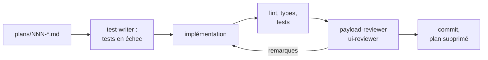

# Workflows d'agents

[English](agent-workflows.md) · **Français**

Comment Claude Code est configuré pour travailler sur ce dépôt : ce que fait
chaque pièce, quand l'utiliser, et ce qui reste à faire à la main. Tout ce qui
est décrit ici propose des changements à relire. Rien ne merge, ne déploie ni
n'écrit dans le CMS de production tout seul.

Il y a trois niveaux :

- **Des commandes** à lancer dans Claude Code (`/ship-plan`, `/security-sweep`…).
  Chacune est un skill dans [`.claude/skills/`](../.claude/skills/).
- **Des sous-agents** que ces commandes appellent pour un second avis : deux
  reviewers et un rédacteur de tests, dans [`.claude/agents/`](../.claude/agents/).
  Ils démarrent sans le contexte de la conversation, donc ils jugent le diff,
  pas le raisonnement qui l'a produit.
- **Des workflows GitHub** qui font une partie de ce travail sans toi : un
  balayage de sécurité quotidien et une revue des pull requests, dans
  [`.github/workflows/`](../.github/workflows/).

En dessous, trois hooks dans [`.claude/settings.json`](../.claude/settings.json)
s'appliquent à chaque fichier que Claude modifie. Le premier bloque les
modifications des `.env*`, du lockfile et des fichiers générés, le deuxième
formate le fichier avec Prettier, et le troisième régénère `payload-types.ts`
après un changement de schéma.

## En un coup d'œil

| Tu veux…                                                       | Lancer                                                | Où ça s'arrête                                             |
| -------------------------------------------------------------- | ----------------------------------------------------- | ---------------------------------------------------------- |
| Livrer un changement que tu as planifié                        | `/ship-plan 007`                                      | Un commit local, avant le push                             |
| Traiter les alertes de sécurité                                | `/security-sweep`                                     | Un commit local, ou une PR quand c'est la CI qui le lance  |
| Mettre à jour Payload (ou réparer la PR Payload de Dependabot) | `/upgrade-payload 3.92.0` ou `/upgrade-payload 123`   | Un commit local, avant le push                             |
| Modifier le schéma de la base                                  | `/new-migration add_project_tagline`                  | Un fichier de migration, prouvé par une migration complète |
| Vérifier une branche avant d'ouvrir une PR                     | `/pre-pr` (ajouter `--e2e` pour les tests navigateur) | Un rapport, sans aucun changement                          |
| Relire les textes fr/en du site                                | `/content-audit`                                      | Un fichier de textes dans `plans/`                         |
| Vérifier que la production va bien                             | `/site-health`                                        | Un rapport dans `plans/`                                   |
| Savoir si une PR Dependabot peut être mergée                   | `/triage-deps 79`                                     | Un verdict, rien n'est mergé                               |
| Regarder staging avant une release                             | `/preview-check` (ou `/preview-check local`)          | Des captures et un rapport dans `plans/`                   |
| Mettre staging en production                                   | `/release`, puis `/release verify` après le merge     | La PR de release, puis un rapport sur la prod              |
| Faire relire une PR sur GitHub                                 | Ajouter le label `review` à la PR                     | Des commentaires sur les lignes de la PR                   |

## Les commandes

### `/ship-plan NNN` : du plan au commit

La boucle principale, pour n'importe quel changement. Tu écris le plan, Claude
fait le reste et s'arrête avant que quoi que ce soit ne quitte ta machine.

1. **Écrire le plan** dans `plans/`, à partir de
   [`plan-template.md`](../.claude/skills/ship-plan/plan-template.md). Les
   sections **Target** (ce qui doit être vrai à la fin) et **Vérification**
   (comment le prouver) sont obligatoires. **Décisions ouvertes** liste ce que
   Claude doit te demander au lieu de le deviner.
2. **Lancer `/ship-plan NNN`.** La commande lit les **Décisions** de
   `plans/README.md` (elles s'imposent au plan), crée une branche depuis
   `staging`, et fait écrire les tests par `test-writer` à partir de la Target,
   avant que le code n'existe : ils échouent d'abord. Ensuite elle implémente,
   lance les vérifications, et fait relire le diff par les reviewers. Chaque
   remarque est corrigée, rejetée avec une raison, ou reportée dans le backlog.
3. **Lire le rapport.** Il liste ce qu'il te reste à vérifier à l'œil : le
   ressenti d'une animation, le mobile sur un vrai téléphone, le mode sombre,
   les deux langues.
4. **Pousser et ouvrir la PR** avec la commande qu'il te donne.

`plans/` est ignoré par git exprès, puisque le dépôt est public. Une fois un
plan livré, son résumé vit dans le message du commit (`Plan: NNN`). Le fichier
est supprimé, et ce qu'il laissait de côté passe dans le **Backlog** de
`plans/README.md`.

### `/security-sweep` : ce que Dependabot et CodeQL laissent ouvert

Dependabot ouvre les PR de mise à jour tout seul. Il ne sait pas corriger une
dépendance **transitive** vulnérable dont le parent impose l'ancienne version,
et CodeQL se contente de signaler. Le balayage s'occupe des deux, et des PR
Dependabot dont la CI est rouge :

- **Alertes transitives** : une surcharge `pnpm.overrides` limitée à la plage
  vulnérable et épinglée sur la première version corrigée
  (`"undici@<7.29.1": "7.29.1"`), installée avec un délai minimum de 3 jours
  après publication, comme le délai de Dependabot.
- **Aucun correctif possible** (pas de version corrigée, ou seulement en
  changeant de version majeure) : une proposition de rejet de l'alerte, avec sa
  raison et la commande `gh api` exacte. Il ne rejette jamais rien lui-même.
- **Alertes CodeQL** : la plus petite modification de code qui satisfait la règle.
- **PR Dependabot en échec** : un petit correctif poussé sur la branche de la
  PR, ou un diagnostic en commentaire si le changement est plus gros.

Il ne touche jamais aux versions de `payload`, `@payloadcms/*`, `next` et
`react` : elles relèvent de `/upgrade-payload`. Les alertes Dependabot se
ferment quand le correctif arrive sur `main`, pas au merge de la PR du balayage.

En local, la commande fait la boucle complète, vérifications comprises. Le
workflow quotidien lance le même skill en mode CI (voir
[Les workflows GitHub](#les-workflows-github)).

### `/upgrade-payload <version | numéro de PR>`

Une mise à jour de Payload peut modifier la base sans aucun changement de
config de notre côté : la 3.90 a ajouté des colonnes, la 3.91 seize index.
Vercel lance `payload migrate` à chaque déploiement, donc une migration
manquante casse le site, pas seulement un test.

La commande lit les notes de version pour ce qui concerne ce projet, régénère
les types et l'import map de l'admin, et lance le test de dérive du schéma
(voir plus bas). À partir de son résultat, elle écrit la migration, puis lance
toutes les vérifications, e2e compris, et payload-reviewer. Une nouvelle
version majeure (4.x) devient un plan à la place.

Avec un numéro de PR, elle travaille sur la PR `payload-next-react` de
Dependabot. Cette PR peut être incomplète : pour la 3.91, elle montait `payload`
mais pas `@payloadcms/*`.

### `/new-migration <slug>`

`payload migrate:create` ne fonctionne pas dans ce dépôt : ses instantanés sont
périmés. Les migrations s'écrivent à la main, et c'est ce que fait cette
commande. Elle part du SQL affiché par le test de dérive, le rend idempotent,
écrit un `down` qui l'annule, l'enregistre dans `src/migrations/index.ts`, et
le prouve avec `migrate`, `migrate:down`, `migrate`, puis les tests
d'intégration.

### `/pre-pr [--e2e]`

Les mêmes vérifications que la CI, en local : lint, typecheck, couverture des
tests unitaires, intégration, et e2e avec `--e2e`. Elle vérifie aussi les
messages de commit (release-please ignore les autres), qu'un changement de
schéma s'accompagne d'une migration, et que les types générés sont à jour.
Elle fait un rapport et ne modifie rien.

### `/content-audit [URL du site]`

Lit tous les globals et collections publiques via l'API publique de Payload,
dans les deux langues à la fois, et vérifie :

- les champs remplis dans une seule langue, et les textes restés non traduits ;
- les coquilles et la typographie française et anglaise ;
- les noms et intitulés de poste écrits de façon différente selon les pages ;
- les descriptions SEO manquantes ;
- les informations dépassées par rapport à ton profil.

Elle écrit `plans/textes-audit-<date>.md`, où chaque bloc est le texte complet
d'un champ, prêt à coller dans l'admin. Elle n'écrit jamais dans Payload. Les
médias ne sont pas publics, donc les textes alternatifs des images ne sont pas
couverts.

### `/site-health [URL du site]`

Un bilan hebdomadaire de la production, comparé au précédent :

- les déploiements, les erreurs d'exécution et le trafic, via le connecteur Vercel ;
- chaque page du sitemap et chaque lien externe du contenu ;
- Lighthouse et les Core Web Vitals sur trois pages, via chrome-devtools.

Elle écrit `plans/sante-<date>.md` et ajoute les vrais problèmes au Backlog.
Lecture seule : aucun déploiement, retour en arrière ni changement de
variable. Le vérificateur de liens ignore les hôtes locaux et ne suit pas les
redirections.

### `/triage-deps <numéro de PR>`

Pour toute PR Dependabot, sauf Payload/Next/React (celles-là passent par
`/upgrade-payload`). La commande lit tous les changelogs entre les deux
versions et cherche dans le code les API qui ont changé. Elle merge ensuite
la PR dans le `staging` actuel, sur une branche jetable, et lance toutes les
vérifications, e2e compris. Pour un paquet qui tourne dans le navigateur
(motion, next-themes, la lightbox), elle démarre aussi le build de production
avec les données de test, et mesure les écrans concernés avec
chrome-devtools : les apparitions qui finissent visibles, les valeurs liées
au scroll, le mouvement réduit, la console.

Le verdict est **mergeable**, **mergeable, à vérifier à l'œil** (avec les
cinq minutes de choses à regarder sur staging) ou **bloquant**. Il dit aussi
quand merger par rapport à la release en attente. La commande ne merge, ne
pousse et ne commente rien, et te laisse sur un `staging` propre.

### `/preview-check [local | URL]`

Ce que les tests ne voient pas : une ombre perdue en mode sombre, un menu qui
saute, un ressort qui n'a plus le même ressenti. Vercel ne déploie que
`staging` et `main`, donc la commande compare **le déploiement de staging
avec la production** :

- des captures pleine page de l'accueil, d'un projet, du journal, d'un
  article et de la 404, en fr/en, clair/sombre, ordinateur/mobile, côte à
  côte ;
- les interactions : menu mobile, thème, langue, filtres du journal,
  inclinaison des cartes, barre de lecture, validation du formulaire de
  contact (jamais envoyé) ;
- le mouvement réduit, et la console sur chaque page.

Avec `local`, elle vérifie la branche en cours sur le build de test, et ne
cherche que les mises en page cassées. Les captures vont dans
`plans/.preview/`. Lecture seule.

### `/release` et `/release verify`

Une release, c'est trois merges dans un ordre fixe, puis un déploiement qui
lance `payload migrate` sur la base de production. `/release` :

1. trie les PR ouvertes : part maintenant, a d'abord besoin d'un verdict,
   attend ;
2. vérifie que la CI de staging et son déploiement Vercel sont verts ;
3. lit chaque migration qui va tourner sur la production ;
4. ouvre ou met à jour la PR `staging → main`, construite à partir des
   commits et de la PR release-please ;
5. te donne l'ordre des merges. C'est toi qui merges.

Après le merge, `/release verify` vérifie la production sur Vercel : le build
est `READY`, `payload migrate` a appliqué chaque nouvelle migration, aucune
nouvelle erreur d'exécution, chaque page principale répond 200, la release
GitHub existe. Si la prod est cassée, elle le dit et explique comment revenir
en arrière, sans le faire.

## Les sous-agents

Tu les appelles rarement toi-même, puisque les commandes les lancent. Tu peux
quand même en demander un directement, par exemple « demande à
payload-reviewer de relire cette branche ».

| Agent                                                       | Regarde                                                                                                                                                                                                                                    | Écrit                                                                  |
| ----------------------------------------------------------- | ------------------------------------------------------------------------------------------------------------------------------------------------------------------------------------------------------------------------------------------ | ---------------------------------------------------------------------- |
| [`payload-reviewer`](../.claude/agents/payload-reviewer.md) | Le back-end : règles d'accès (les API REST et GraphQL sont publiques), schéma comparé aux migrations, tags de cache et revalidation, `visibility` et `locale` dans les requêtes, server actions, hooks qui appellent des services externes | Rien, il fait un rapport                                               |
| [`ui-reviewer`](../.claude/agents/ui-reviewer.md)           | Le front-end : les deux langues, les tokens d'animation et le mouvement réduit, le survol sur écran tactile, l'accessibilité, la direction artistique arrondie du site, la frontière serveur/client                                        | Rien, il fait un rapport                                               |
| [`test-writer`](../.claude/agents/test-writer.md)           | La Target d'un plan                                                                                                                                                                                                                        | Des tests sous `tests/`, au niveau le plus bas qui suffit à la prouver |

## Le test de dérive du schéma

[`tests/int/schemaDrift.int.spec.ts`](../tests/int/schemaDrift.int.spec.ts)
tourne avec les tests d'intégration, en local comme en CI. Il construit la base
à partir des seules migrations, demande à Drizzle ce qu'il changerait pour
qu'elle corresponde à la config, et échoue en affichant ce SQL. Un changement
de schéma sans sa migration fait donc échouer la CI, qu'il vienne de ta config
ou d'une mise à jour de Payload, et le message d'échec est le point de départ
de la migration. Les valeurs par défaut des colonnes sont ignorées : Payload
les applique lui-même.

## Les workflows GitHub

| Workflow                                                        | Se lance                                                              | Fait                                                                                                                                                                                                                                                     |
| --------------------------------------------------------------- | --------------------------------------------------------------------- | -------------------------------------------------------------------------------------------------------------------------------------------------------------------------------------------------------------------------------------------------------- |
| [`ci.yml`](../.github/workflows/ci.yml)                         | À chaque push et chaque PR                                            | Lint, typecheck, tests unitaires, d'intégration (test de dérive compris) et e2e (sautés sur les PR qui ne touchent qu'à la doc, `.claude/` ou la config GitHub), et sur les PR la vérification des docs fr/en ci-dessous. Son token est en lecture seule |
| [`claude-review.yml`](../.github/workflows/claude-review.yml)   | Quand une PR vers `staging` reçoit le label `review`, et seulement là | Lance payload-reviewer et/ou ui-reviewer sur le diff, vérifie chaque remarque, poste celles qui sont confirmées en commentaires sur les lignes, plus un résumé                                                                                           |
| [`security-sweep.yml`](../.github/workflows/security-sweep.yml) | Chaque nuit à 0 h 17 UTC, et à la main depuis l'onglet Actions        | Récupère les alertes ouvertes. Si la liste a changé depuis le dernier passage, lance `/security-sweep` en mode CI et ouvre ou met à jour une seule PR vers `staging`                                                                                     |
| [`release.yml`](../.github/workflows/release.yml)               | Push sur `staging`                                                    | La PR de version de release-please (voir le README)                                                                                                                                                                                                      |

La revue ignore les brouillons, les forks, Dependabot, release-please, la PR de
release, la PR du balayage lui-même, et les PR qui ajoutent des liens
symboliques. Pour faire relire de nouveaux commits sur une PR, retirer le label
`review` puis le remettre. Elle ne tourne jamais toute seule : mets le label
sur les PR faites à la main, les gros changements, et tout ce qui touche aux
règles d'accès ou à la base. Un changement livré avec `/ship-plan` a déjà été
relu par les mêmes agents.

**La vérification des docs fr/en** fait échouer une PR qui modifie
`README.md` ou un `docs/*.md` sans son jumeau `.fr.md`, ou l'inverse. Chaque
`*.fr.md` suivi par git est apparié automatiquement. Pour un changement
vraiment d'un seul côté (une coquille en français), ajoute une ligne
`Docs-Sync: skip` dans un des messages de commit de la PR.

**En mode CI, le balayage n'exécute aucun code de dépendance** : il installe
avec `--ignore-scripts` et ne lance aucun test. La PR qu'il ouvre est vérifiée
par `ci.yml`, dont le token est en lecture seule.

### Ce qui consomme ton quota Claude

Deux workflows lancent Claude tout seuls, avec `CLAUDE_CODE_OAUTH_TOKEN`. Ils
comptent donc dans les mêmes limites d'abonnement que ton propre usage de
Claude :

| Workflow             | Quand Claude tourne vraiment                                                                                                                                                                            | Coût habituel                                                     |
| -------------------- | ------------------------------------------------------------------------------------------------------------------------------------------------------------------------------------------------------- | ----------------------------------------------------------------- |
| `claude-review.yml`  | Seulement quand tu ajoutes le label `review` à une PR vers `staging`. Jamais tout seul, et jamais sur Dependabot, release-please, la PR de release ni le balayage                                       | Une session de revue par PR, plus longue si le diff est gros      |
| `security-sweep.yml` | Démarre chaque nuit à 0 h 17 UTC (2 h 17 à Paris l'été, 1 h 17 l'hiver), mais Claude ne tourne que si l'ensemble des alertes ouvertes a changé depuis la dernière fois, ou quand tu le lances à la main | Rien la plupart des jours ; une session quand les alertes bougent |

Tout le reste n'en consomme pas : `ci.yml` et `release.yml` n'appellent pas
Claude, et les commandes ci-dessus ne tournent que quand tu les tapes, dans ta
propre session. Pour en mettre un en pause : onglet Actions, ⋯ → Disable
workflow.

### Ce qui protège ces workflows

Les deux confient un token capable d'écrire dans le dépôt à un agent qui lit
du texte écrit par des tiers (alertes, contenu des PR), sur un dépôt public.
Une série de revues de sécurité automatiques, et CodeQL, les ont façonnés :

- Claude ne peut lancer qu'une liste précise de commandes. Tout ce qui pourrait
  publier un fichier, lancer un programme via git ou lire hors du dépôt est
  interdit (`--body-file`, `difftool`, `/proc`, substitution de commande…).
- La revue charge ses règles (`.claude/`, tous les `CLAUDE.md` et `AGENTS.md`)
  depuis `staging` : une PR ne peut pas réécrire sa propre revue.
- Le token des alertes ne sert qu'à l'étape de collecte, jamais à Claude. Le
  texte des alertes est nettoyé et traité comme une donnée, pas comme une
  instruction.
- Chaque action est épinglée sur un commit précis, et Dependabot tient ces
  épinglages à jour.

Les vraies limites sont côté GitHub : la protection des branches et les
permissions de l'app. Voir l'installation ci-dessous.

## Installation

Ce qui doit exister pour que la partie GitHub fonctionne :

1. **L'app GitHub Claude** sur ce dépôt : `/install-github-app` dans Claude
   Code, ou https://github.com/apps/claude. Ne pas ajouter les workflows
   qu'elle propose : ce dépôt a les siens.
2. **Le secret `CLAUDE_CODE_OAUTH_TOKEN`** : `claude setup-token`, connecté avec
   le compte claude.ai qui a l'abonnement Pro ou Max, puis
   `gh secret set CLAUDE_CODE_OAUTH_TOKEN -R zolangivre/portfolio`. Les passages
   consomment le quota de cet abonnement.
3. **Le secret `SECURITY_ALERTS_TOKEN`** : un token d'accès personnel à
   granularité fine (fine-grained), limité à ce dépôt, avec **Dependabot
   alerts** et **Code scanning alerts** en lecture seule, et rien d'autre.
   `GITHUB_TOKEN` ne peut pas lire les alertes Dependabot. Ce token expire, et
   à ce moment-là le balayage échoue dès sa première étape.
4. **Le label `review`.**
5. **La protection des branches** : une seule règle, `staging and main`, dans
   Settings → Rules → Rulesets. Elle exige une PR, **sans approbation** : GitHub
   ne te laisse pas approuver tes propres PR, donc une approbation bloquerait
   tous les merges. Elle exige que les checks de la CI passent : Changes, Lint &
   typecheck, Unit tests, Integration tests, E2E tests, Docs fr/en in sync. Un
   job sauté par sa condition (une PR de doc, une PR de release) compte comme
   réussi, donc rien ne reste bloqué en attente. Les branches n'ont pas besoin
   d'être à jour avant le merge, sinon chaque PR Dependabot devrait être
   rebasée dès que `staging` bouge. Le force push et la suppression sont
   bloqués. **Repository admin** est dans la liste de contournement, pour les
   urgences ; chaque contournement est enregistré. L'app Claude, elle, ne peut
   pas contourner ces règles.
6. **Les workflows sur `main`.** L'action Claude ne lance qu'un workflow dont le
   fichier est identique sur la branche par défaut, et les workflows planifiés
   ne tournent que depuis celle-ci. Tant qu'une release ne les a pas amenés sur
   `main`, les deux workflows s'arrêtent en quelques secondes sans rien faire.

## Dépannage

| Symptôme                                                                                                  | Cause                                                                                                                       |
| --------------------------------------------------------------------------------------------------------- | --------------------------------------------------------------------------------------------------------------------------- |
| Le job de revue réussit en quelques secondes et ne poste rien ; le log dit « Workflow validation failed » | Le workflow n'est pas encore identique sur `main`, ou la PR le modifie. Dans les deux cas, c'est normal                     |
| Le balayage échoue à « Fetch open alerts »                                                                | `SECURITY_ALERTS_TOKEN` manque ou a expiré                                                                                  |
| Le balayage tourne mais ne fait rien                                                                      | La liste des alertes ouvertes n'a pas changé depuis le dernier passage. Le lancer à la main pour forcer                     |
| Le test de dérive échoue                                                                                  | Il manque une migration. Le message d'erreur donne le SQL ; lancer `/new-migration`                                         |
| Tous les tests e2e échouent avec « Executable doesn't exist »                                             | Playwright a été mis à jour : `pnpm exec playwright install chromium`                                                       |
| Les tests d'intégration ou e2e n'arrivent pas à se connecter                                              | Postgres ne tourne pas : `docker compose up -d postgres`                                                                    |
| `claude setup-token` dit qu'il faut un abonnement Pro ou Max                                              | Le navigateur est connecté à un compte claude.ai sans abonnement. Se connecter avec celui qui l'a (une fenêtre privée aide) |

## Modifier un workflow

Le comportement de chaque commande est dans son `SKILL.md`, et celui de chaque
agent dans son fichier `.md` : ils se modifient comme du code, dans une PR. Une
modification de `.claude/` s'applique à la revue GitHub une fois mergée dans
`staging`. Une modification d'un fichier de workflow s'applique une fois arrivée
sur `main`.
