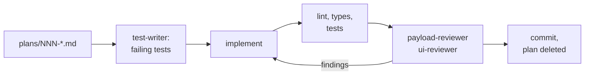

# Agent workflows

**English** · [Français](agent-workflows.fr.md)

How Claude Code is set up to work on this repo: what each piece does, when to
use it, and what you still do by hand. Everything here proposes changes for
you to review. Nothing merges, deploys or writes to the production CMS by
itself.

There are three layers:

- **Commands** you run in Claude Code (`/ship-plan`, `/security-sweep`…). Each
  one is a skill in [`.claude/skills/`](../.claude/skills/).
- **Subagents** those commands call for a second opinion: reviewers and a test
  writer, in [`.claude/agents/`](../.claude/agents/). They start with a fresh
  context, so they judge the diff, not the reasoning that produced it.
- **GitHub workflows** that run some of this without you: a daily security
  sweep and a review on pull requests, in [`.github/workflows/`](../.github/workflows/).

Underneath, three hooks in [`.claude/settings.json`](../.claude/settings.json)
run on every file Claude edits. One blocks edits to `.env*`, the lockfile and
generated files, one formats the file with Prettier, and one regenerates
`payload-types.ts` after a schema change.

## At a glance

| You want to…                                     | Run                                                 | Where it stops                              |
| ------------------------------------------------ | --------------------------------------------------- | ------------------------------------------- |
| Ship a change you've planned                     | `/ship-plan 007`                                    | A local commit, before the push             |
| Clear security alerts                            | `/security-sweep`                                   | A local commit, or a PR when run by CI      |
| Upgrade Payload (or fix Dependabot's Payload PR) | `/upgrade-payload 3.92.0` or `/upgrade-payload 123` | A local commit, before the push             |
| Change the database schema                       | `/new-migration add_project_tagline`                | A migration file, proven by a fresh migrate |
| Check a branch before opening a PR               | `/pre-pr` (add `--e2e` for the browser tests)       | A report, no changes                        |
| Proofread the site's fr/en copy                  | `/content-audit`                                    | A texts file in `plans/`                    |
| Check that production is healthy                 | `/site-health`                                      | A report in `plans/`                        |
| Decide on a Dependabot PR                        | `/triage-deps 79`                                   | A verdict, nothing merged                   |
| Look at staging before releasing                 | `/preview-check` (or `/preview-check local`)        | Screenshots and a report in `plans/`        |
| Ship staging to production                       | `/release`, then `/release verify` after the merge  | The release PR; then a production report    |
| Get a PR reviewed on GitHub                      | Add the `review` label to the PR                    | Inline comments on the PR                   |

## Commands

### `/ship-plan NNN` — from a plan to a commit

The main loop for any change. You write the plan, Claude does the rest and
stops before anything leaves your machine.

1. **Write the plan** in `plans/`, from
   [`plan-template.md`](../.claude/skills/ship-plan/plan-template.md). The
   **Target** (what must be true at the end) and **Vérification** (how to
   prove it) sections are required. **Décisions ouvertes** lists what Claude
   must ask you rather than guess.
2. **Run `/ship-plan NNN`.** It reads the **Décisions** in `plans/README.md`
   (they're binding), creates a branch from `staging`, and has `test-writer`
   write the tests from the Target before any code exists, so they fail first.
   Then it implements, runs the checks, and has the reviewers look at the diff.
   Their findings are fixed, rejected with a reason, or deferred to the backlog.
3. **Read the report.** It lists what still needs your eye: how an animation
   feels, mobile on a real phone, dark mode, both locales.
4. **Push and open the PR** with the command it gives you.

`plans/` is gitignored on purpose, since the repo is public. Once a plan
ships, its summary lives in the commit message (`Plan: NNN`). The file is
deleted, and anything it left out moves to the **Backlog** in
`plans/README.md`.

### `/security-sweep` — what Dependabot and CodeQL leave open

Dependabot opens version PRs on its own. It can't fix a vulnerable
**transitive** dependency whose parent pins the old version, and CodeQL only
reports. The sweep handles both, and the Dependabot PRs whose CI is red:

- **Transitive alerts**: a `pnpm.overrides` entry scoped to the vulnerable
  range and pinned to the first patched version (`"undici@<7.29.1": "7.29.1"`),
  installed with a 3-day minimum release age, like Dependabot's cooldown.
- **No fix possible** (no patched version, or only across a major): a
  dismissal proposal with its reason and the exact `gh api` command. It never
  dismisses anything itself.
- **CodeQL alerts**: the smallest code change that satisfies the rule.
- **Red Dependabot PRs**: a small fix pushed to the PR's branch, or a
  diagnosis comment if the change is bigger.

It never touches the `payload`, `@payloadcms/*`, `next` and `react` versions:
those belong to `/upgrade-payload`. Dependabot alerts close once the fix
reaches `main`, not when the sweep's PR merges.

Run it locally for the full loop, checks included. The daily workflow runs
the same skill in CI mode (see [GitHub workflows](#github-workflows)).

### `/upgrade-payload <version | PR number>`

Payload upgrades can change the database without any config change on our
side: 3.90 added columns, 3.91 added 16 indexes. Vercel runs `payload migrate`
on every deploy, so a missing migration breaks the site, not just a test.

The command reads the release notes for what touches this project,
regenerates the types and the admin import map, and runs the schema drift
test (below). From its output it writes the migration, then runs every check,
e2e included, and payload-reviewer. A new major (4.x) becomes a plan instead.

Given a PR number, it works on Dependabot's `payload-next-react` PR. That PR
can be incomplete: for 3.91 it bumped `payload` but not `@payloadcms/*`.

### `/new-migration <slug>`

`payload migrate:create` doesn't work in this repo: its snapshots are stale.
Migrations are written by hand, and this command does it. It starts from the
SQL the drift test prints, makes it idempotent, writes a `down` that reverses
it, registers it in `src/migrations/index.ts`, and proves it with `migrate`,
`migrate:down`, `migrate`, then the integration suite.

### `/pre-pr [--e2e]`

The same checks as CI, run locally: lint, typecheck, unit coverage,
integration, and e2e with `--e2e`. It also checks the commit messages
(release-please ignores the rest), that a schema change comes with a
migration, and that the generated types are up to date. It reports and
changes nothing.

### `/content-audit [site URL]`

Reads every global and public collection through the public Payload API,
both locales at once, and checks:

- fields filled in one locale only, and copy left untranslated;
- typos and French/English typography;
- names and job titles spelled differently across the site;
- missing SEO descriptions;
- facts out of date against your profile.

It writes `plans/textes-audit-<date>.md`, each block the full text of a field,
ready to paste in the admin. It never writes to Payload. Media aren't public,
so image alt texts aren't covered.

### `/site-health [site URL]`

A weekly look at production, compared with the previous check:

- deployments, runtime errors and traffic, through the Vercel connector;
- every sitemap page and every external link in the content;
- Lighthouse and Core Web Vitals on three pages, through chrome-devtools.

It writes `plans/sante-<date>.md` and adds real problems to the Backlog.
Read-only: no deploy, rollback or env change. The link checker skips local
hosts and doesn't follow redirects.

### `/triage-deps <PR number>`

For any Dependabot PR except Payload/Next/React (those go to
`/upgrade-payload`). It reads every changelog between the two versions,
searches the code for the APIs that changed, then merges the PR into current
`staging` on a throwaway branch and runs every check, e2e included. For a
package that runs in the browser (motion, next-themes, the lightbox) it also
starts the seeded production build and measures the affected screens with
chrome-devtools: reveals that end visible, scroll-driven values, reduced
motion, console.

The verdict is **mergeable**, **mergeable, check by eye** (with the five
minutes of things to look at on staging) or **blocking**, plus when to merge
it relative to the pending release. It never merges, pushes or comments, and
leaves you on a clean `staging`.

### `/preview-check [local | URL]`

What the tests can't see: a shadow lost in dark mode, a menu that jumps, a
spring that feels different. Vercel only deploys `staging` and `main`, so it
compares the **staging deployment with production**:

- full-page screenshots of the home, a project, the journal, an entry and the
  404, in fr/en, light/dark, desktop/mobile, side by side;
- the interactions: mobile menu, theme, language, journal filters, card
  tilt, reading progress, contact form validation (never sent);
- reduced motion, and the console on every page.

With `local`, it checks the current branch on the seeded build instead, for
broken layout only. Screenshots go to `plans/.preview/`. Read-only.

### `/release` and `/release verify`

A release is three merges in a fixed order, then a deploy that runs
`payload migrate` on production. `/release`:

1. sorts the open PRs into ships now / needs a verdict first / waits;
2. checks that staging's CI and its Vercel deployment are green;
3. reads every migration that will run against production;
4. opens or updates the `staging → main` PR, built from the commits and the
   release-please PR;
5. gives you the merge order. You merge.

After the merge, `/release verify` checks production on Vercel: the build is
`READY`, `payload migrate` applied each new migration, no new runtime error,
every main page answers 200, the GitHub release exists. If production is
broken it says so and how to roll back, but doesn't.

## Subagents

You rarely call these yourself, since the commands launch them. You can still
ask for one directly, for example "ask payload-reviewer to review this branch".

| Agent                                                       | Looks at                                                                                                                                                                                                       | Writes                                                   |
| ----------------------------------------------------------- | -------------------------------------------------------------------------------------------------------------------------------------------------------------------------------------------------------------- | -------------------------------------------------------- |
| [`payload-reviewer`](../.claude/agents/payload-reviewer.md) | The back end: access rules (the REST and GraphQL APIs are public), schema vs. migrations, cache tags and revalidation, `visibility` and `locale` in queries, server actions, hooks that call external services | Nothing, it reports                                      |
| [`ui-reviewer`](../.claude/agents/ui-reviewer.md)           | The front end: both locales, motion tokens and reduced motion, hover on touch screens, accessibility, the site's rounded design direction, the server/client boundary                                          | Nothing, it reports                                      |
| [`test-writer`](../.claude/agents/test-writer.md)           | A plan's Target                                                                                                                                                                                                | Tests under `tests/`, at the lowest layer that proves it |

## The schema drift test

[`tests/int/schemaDrift.int.spec.ts`](../tests/int/schemaDrift.int.spec.ts)
runs with the integration suite, locally and in CI. It builds the database
from the migrations alone, asks Drizzle what it would change to match the
config, and fails with that SQL. So a schema change without its migration
fails CI, whether it comes from your config or from a Payload upgrade, and
the failure message is the migration's starting point. Column defaults are
ignored: Payload applies them itself.

## GitHub workflows

| Workflow                                                        | Runs                                                       | Does                                                                                                                                            |
| --------------------------------------------------------------- | ---------------------------------------------------------- | ----------------------------------------------------------------------------------------------------------------------------------------------- |
| [`ci.yml`](../.github/workflows/ci.yml)                         | Every push and PR                                          | Lint, typecheck, unit, integration (drift test included), e2e, and on PRs the fr/en docs check below. The token is read-only                    |
| [`claude-review.yml`](../.github/workflows/claude-review.yml)   | A PR into `staging` gets the `review` label, and only then | Runs payload-reviewer and/or ui-reviewer on the diff, checks each finding, posts the confirmed ones as inline comments, plus a summary          |
| [`security-sweep.yml`](../.github/workflows/security-sweep.yml) | Nightly at 00:17 UTC, and by hand from the Actions tab     | Fetches the open alerts. If the set changed since the last run, runs `/security-sweep` in CI mode and opens or updates one PR against `staging` |
| [`release.yml`](../.github/workflows/release.yml)               | Push to `staging`                                          | release-please's version PR (see the README)                                                                                                    |

The review skips drafts, forks, Dependabot, release-please, the release PR,
the sweep's own PR, and PRs that add symlinks. To review new commits on a PR,
remove the `review` label and add it again. It never runs on its own: add the
label to PRs made by hand, big changes, and anything touching access rules or
the database. A change shipped with `/ship-plan` was already reviewed by the
same agents.

**The fr/en docs check** fails a PR that changes `README.md` or a
`docs/*.md` without its `.fr.md` twin, or the reverse. Every tracked
`*.fr.md` is paired automatically. For a change that really is one-sided (a
French typo), add a `Docs-Sync: skip` line to one of the PR's commit messages.

**In CI mode the sweep runs no dependency code**: it installs with
`--ignore-scripts` and runs no tests. The PR it opens is verified by
`ci.yml`, whose token is read-only.

### What uses your Claude quota

Two workflows run Claude on their own, with `CLAUDE_CODE_OAUTH_TOKEN`, so
they count against the same subscription limits as your own use of Claude:

| Workflow             | When Claude actually runs                                                                                                                                                              | Typical cost                                    |
| -------------------- | -------------------------------------------------------------------------------------------------------------------------------------------------------------------------------------- | ----------------------------------------------- |
| `claude-review.yml`  | Only when you add the `review` label to a PR into `staging`. Never on its own, and never on Dependabot, release-please, the release PR or the sweep                                    | One review session per PR, longer for big diffs |
| `security-sweep.yml` | Starts every night at 00:17 UTC (02:17 in Paris in summer, 01:17 in winter), but Claude only runs when the set of open alerts changed since the last run, or when you start it by hand | Most days nothing; a session when alerts move   |

Everything else uses none: `ci.yml` and `release.yml` don't call Claude, and
the commands above only run when you type them, inside your own session. To
pause one, disable it in the Actions tab (⋯ → Disable workflow).

### What protects these workflows

Both hand a token that can write to the repo to an agent that reads
third-party text (alerts, PR content), on a public repository. A series of
automated security reviews, and CodeQL, shaped them:

- Claude may only run an exact list of commands. Everything that could
  publish a file, run a program through git, or read outside the checkout is
  denied (`--body-file`, `difftool`, `/proc`, command substitution…).
- The review loads its rules (`.claude/`, every `CLAUDE.md` and `AGENTS.md`)
  from `staging`, so a PR can't rewrite its own review.
- The alerts token is only used by the fetch step, never by Claude. The text
  of alerts is cleaned and treated as data, not instructions.
- Every action is pinned to a commit, and Dependabot keeps the pins current.

The real limits are on GitHub's side: branch protection, and the app's
permissions. See the setup below.

## Setup

What has to exist for the GitHub side to work:

1. **The Claude GitHub App** on this repository: `/install-github-app` in
   Claude Code, or https://github.com/apps/claude. Don't add the workflows it
   offers: this repo has its own.
2. **Secret `CLAUDE_CODE_OAUTH_TOKEN`**: `claude setup-token`, signed in with
   the claude.ai account that has the Pro or Max subscription, then
   `gh secret set CLAUDE_CODE_OAUTH_TOKEN -R zolangivre/portfolio`. Runs use
   that subscription's quota.
3. **Secret `SECURITY_ALERTS_TOKEN`**: a fine-grained personal access token on
   this repository only, with **Dependabot alerts** and **Code scanning
   alerts** read-only and nothing else. `GITHUB_TOKEN` can't read Dependabot
   alerts. It expires, and when it does the sweep fails at its first step.
4. **The `review` label.**
5. **Branch protection** on `staging` and `main` (Settings → Rules →
   Rulesets): require a PR with one approval, require the four CI checks, block
   force pushes, with **Repository admin** on the bypass list. GitHub won't let
   you approve your own PR, so without the bypass you couldn't merge yours.
   The Claude app can't bypass it.
6. **The workflows on `main`.** Claude's action only runs a workflow whose
   file is identical on the default branch, and scheduled workflows only run
   from it. Until a release brings them to `main`, both workflows exit in a few
   seconds without doing anything.

## Troubleshooting

| Symptom                                                                                         | Cause                                                                                                                               |
| ----------------------------------------------------------------------------------------------- | ----------------------------------------------------------------------------------------------------------------------------------- |
| The review job succeeds in seconds and posts nothing; the log says "Workflow validation failed" | The workflow isn't identical on `main` yet, or the PR modifies it. Both are expected                                                |
| The sweep fails at "Fetch open alerts"                                                          | `SECURITY_ALERTS_TOKEN` is missing or expired                                                                                       |
| The sweep runs but does nothing                                                                 | The set of open alerts hasn't changed since the last run. Run it by hand to force it                                                |
| The drift test fails                                                                            | A migration is missing. Its message is the SQL; run `/new-migration`                                                                |
| Every e2e test fails with "Executable doesn't exist"                                            | Playwright was upgraded: `pnpm exec playwright install chromium`                                                                    |
| Integration or e2e can't connect                                                                | Postgres isn't running: `docker compose up -d postgres`                                                                             |
| `claude setup-token` says a Pro or Max plan is needed                                           | The browser is signed in to a claude.ai account without the subscription. Sign in with the one that has it (a private window helps) |

## Changing a workflow

Each command's behaviour lives in its `SKILL.md`, and each agent's in its
`.md` file: edit them like code, in a PR. A change to `.claude/` reaches the
GitHub review once it's merged into `staging`. A change to a workflow file
takes effect once it's on `main`.
