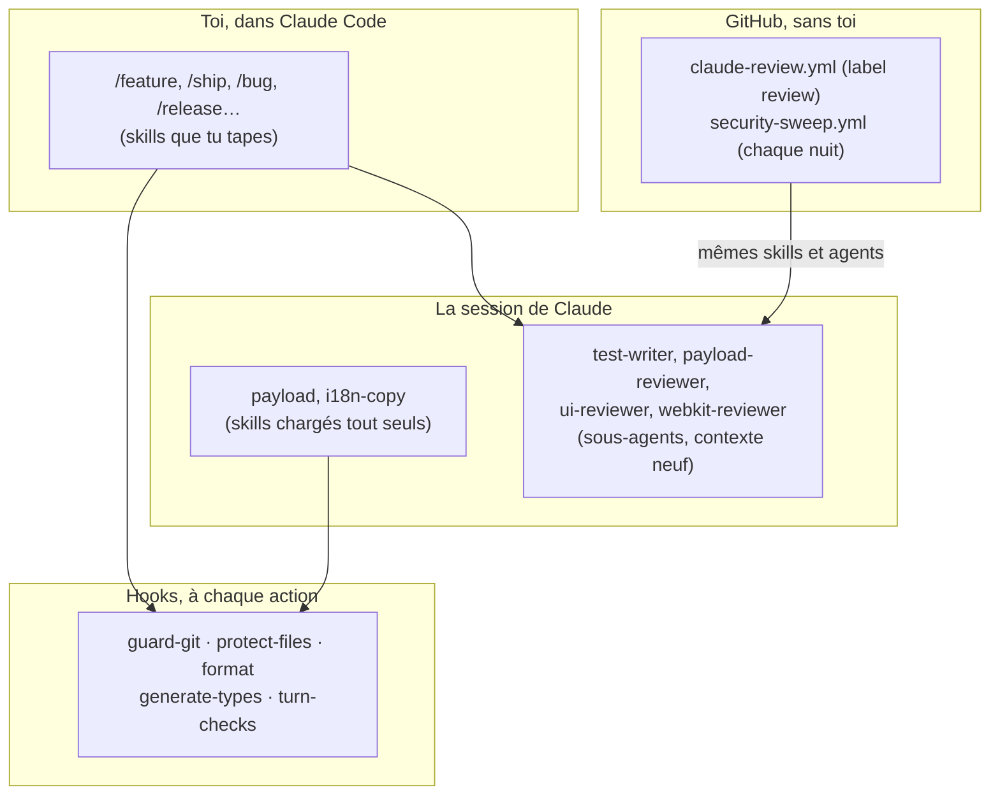
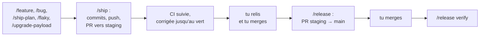

# Claude Code sur ce dépôt

[English](README.md) · **Français**

Comment Claude Code est configuré pour travailler ici : ce que fait chaque
pièce, comment elles s'emboîtent, et ce qui reste à faire à la main. Tout
propose des changements à relire. Les commandes poussent une branche de
travail et ouvrent une PR vers `staging` ; le merge est à toi. Rien ne merge,
ne déploie ni n'écrit dans le CMS de production tout seul.

| Document                                      | Pour                                                                                          |
| --------------------------------------------- | --------------------------------------------------------------------------------------------- |
| [Skills](skills.fr.md)                        | Chaque commande, ce qu'elle fait, où elle s'arrête                                            |
| [Sous-agents](subagents.fr.md)                | Les reviewers et le rédacteur de tests que les commandes appellent                            |
| [Hooks et réglages](hooks-and-settings.fr.md) | Ce qui tourne autour de chaque action de Claude, les permissions, les fichiers d'instructions |
| [Claude sur GitHub](github-agents.fr.md)      | Les deux workflows qui lancent Claude sans toi                                                |
| [Claude dans le CMS (MCP)](mcp.fr.md)         | Lire et modifier le contenu du site depuis Claude, en brouillon seulement                     |

## Quatre niveaux

- **Les skills que tu tapes** (`/feature`, `/ship`, `/security-sweep`…) :
  chacun est un `SKILL.md` dans [`.claude/skills/`](../../.claude/skills/).
  Ils ne tournent que quand tu les tapes. Voir [Skills](skills.fr.md).
- **Les skills que Claude charge tout seul** : `payload` (la référence de
  Payload CMS), `i18n-copy` (les règles du texte visible) et
  `brand-guidelines` (l'identité et le système visuel du site). Claude les
  lit quand la tâche le demande.
- **Les sous-agents** que les commandes appellent pour un second avis, dans
  [`.claude/agents/`](../../.claude/agents/). Ils démarrent avec un contexte
  neuf : ils jugent le diff par rapport au plan, pas le raisonnement qui l'a
  produit. Voir [Sous-agents](subagents.fr.md).
- **Les hooks** dans [`.claude/settings.json`](../../.claude/settings.json),
  scripts dans [`.claude/hooks/`](../../.claude/hooks/). Ils s'appliquent à
  chaque commande et chaque modification, quoi qu'on ait demandé à Claude :
  ils refusent un push sur `staging` ou un merge, protègent les secrets et
  les fichiers générés, lintent et formatent, régénèrent les types, et lancent
  les tests liés avant que Claude s'arrête. Voir
  [Hooks et réglages](hooks-and-settings.fr.md).

Sur GitHub, deux workflows lancent les mêmes skills et agents sans toi : une
revue quand tu ajoutes le label `review` à une PR, et un balayage de sécurité
chaque nuit. Voir [Claude sur GitHub](github-agents.fr.md).

## La boucle

Presque toutes les commandes finissent pareil : une branche, une PR vers
`staging`, la CI suivie jusqu'au vert. Ensuite tu relis et tu merges, et
`/release` emmène `staging` en production.

Ce qui reste à toi, toujours :

- **Approuver un plan.** `/feature` l'écrit et attend ; rien ne change avant
  ton accord.
- **Merger.** `guard-git` refuse `gh pr merge` et l'API de merge. Le ruleset
  `staging and main` exige une PR et une CI verte, mais tu es sur sa liste de
  contournement en tant qu'admin, et le `gh` de Claude tourne avec ton jeton :
  c'est le hook qui garde le merge entre tes mains.
- **Regarder.** Le ressenti d'une animation, le mobile sur un vrai
  téléphone, Safari, le mode sombre, les deux langues. Chaque rapport finit
  par cette liste, et la description de la PR la reprend.
- **Les secrets et la production.** Les `.env*`, les réglages Vercel, l'admin
  et la base de production. Les hooks en bloquent une partie ; les skills
  s'arrêtent avant le reste.

## Le dossier `plans/`

`plans/` est ignoré par git exprès : le dépôt est public. On y trouve :

| Fichier                                   | Écrit par          | Ce que c'est                                                                                              |
| ----------------------------------------- | ------------------ | --------------------------------------------------------------------------------------------------------- |
| `plans/NNN-<slug>.md`                     | toi, ou `/feature` | Un plan par changement, à partir de [`plan-template.md`](../../.claude/skills/ship-plan/plan-template.md) |
| `plans/README.md`                         | toi, et les skills | **En cours** (plans en cours), **Backlog** (relevé mais pas planifié), **Décisions** (contraignantes)     |
| `plans/textes-audit-<date>.md`            | `/content-audit`   | Les textes corrigés, prêts à coller dans l'admin                                                          |
| `plans/sante-<date>.md`, `plans/.health/` | `/site-health`     | Le bilan hebdomadaire, et les chiffres pour la comparaison suivante                                       |
| `plans/.preview/<date>/`                  | `/preview-check`   | Les captures de staging et de la prod côte à côte                                                         |
| `plans/.content-audit/`                   | `/content-audit`   | Les réponses de l'API et les paires fr/en lues                                                            |

Un plan a trois parties obligatoires : **Target** (ce qui doit être vrai à la
fin, avec les valeurs exactes et les libellés en fr et en), **Vérification**
(comment le prouver) et **Décisions ouvertes** (ce que Claude doit demander
plutôt que deviner, vide une fois tranché). Les **Décisions** de
`plans/README.md` lient chaque plan et chaque agent : un choix tranché là
n'est pas rouvert sans le dire.

Une fois un plan livré, son résumé vit dans le message du commit
(`Plan: NNN`), le fichier est supprimé, et ce qu'il laissait de côté passe
dans le **Backlog**.

## Ce qui consomme ton quota Claude

| Quoi                                                                | Quand Claude tourne                                                                                                      |
| ------------------------------------------------------------------- | ------------------------------------------------------------------------------------------------------------------------ |
| Les commandes                                                       | Seulement quand tu les tapes, dans ta propre session                                                                     |
| [`claude-review.yml`](github-agents.fr.md#la-revue-de-pr)           | Seulement quand tu ajoutes le label `review` à une PR vers `staging`                                                     |
| [`security-sweep.yml`](github-agents.fr.md#le-balayage-de-sécurité) | Démarre chaque nuit, mais Claude ne tourne que si l'ensemble des alertes ouvertes a changé, ou si tu le lances à la main |

`ci.yml`, `release.yml`, `production-check.yml`, Dependabot et le hook git n'appellent pas Claude.
Les deux workflows utilisent `CLAUDE_CODE_OAUTH_TOKEN` : ils comptent dans
les mêmes limites d'abonnement que tes propres sessions. Pour en mettre un en
pause, désactive-le dans l'onglet Actions (⋯ → Disable workflow).

## Modifier la configuration

Le comportement de chaque commande vit dans son `SKILL.md`, celui de chaque
agent dans son `.md`, chaque hook dans son script : on les modifie comme du
code, dans une PR.

- Un changement sous `.claude/` (skills, agents, hooks, `settings.json`)
  change en général ce que ces docs décrivent. Le hook `turn-checks` demande à
  Claude de vérifier `docs/ai/` quand il modifie la configuration sans y
  toucher.
- `.claude/` atteint la revue GitHub une fois mergé dans `staging` (la revue
  lit ses règles de là, jamais de la PR).
- Un fichier de workflow prend effet une fois sur `main`.
- `.claude/skills/payload/` est une référence générale de Payload CMS, pas
  écrite pour ce dépôt. Codex en lit une copie dans `.agents/skills/payload/`
  (locale, ignorée par git) : mets les deux à jour ensemble.
