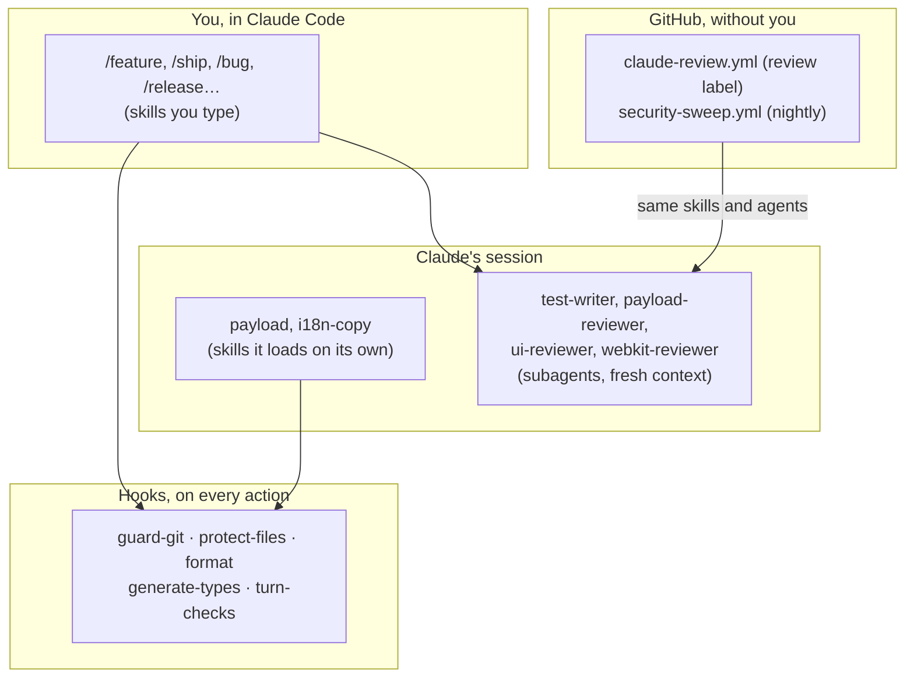
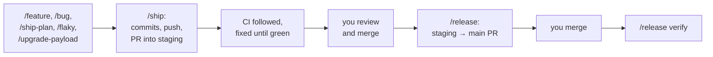

# Claude Code on this repo

**English** · [Français](README.fr.md)

How Claude Code is set up to work here: what each piece does, how they fit,
and what you still do by hand. Everything proposes changes for you to review.
Commands push a work branch and open a PR into `staging`; merging it is yours.
Nothing merges, deploys or writes to the production CMS by itself.

| Document                                    | For                                                                       |
| ------------------------------------------- | ------------------------------------------------------------------------- |
| [Skills](skills.md)                         | Every command, what it does, where it stops                               |
| [Subagents](subagents.md)                   | The reviewers and the test writer the commands call                       |
| [Hooks and settings](hooks-and-settings.md) | What runs around each of Claude's actions, permissions, instruction files |
| [Claude on GitHub](github-agents.md)        | The two workflows that run Claude without you                             |
| [Claude in the CMS (MCP)](mcp.md)           | Reading and editing the site's content from Claude, drafts only           |

## Four layers

- **Skills you type** (`/feature`, `/ship`, `/security-sweep`…): each one is a
  `SKILL.md` in [`.claude/skills/`](../../.claude/skills/). They only run
  when you type them. See [Skills](skills.md).
- **Skills Claude loads on its own**: `payload` (the Payload CMS reference),
  `i18n-copy` (the rules for visible text) and `brand-guidelines` (the
  site's identity and visual system). Claude reads them when the task calls
  for them.
- **Subagents** the commands call for a second opinion, in
  [`.claude/agents/`](../../.claude/agents/). They start with a fresh
  context, so they judge the diff against the plan, not the reasoning that
  produced it. See [Subagents](subagents.md).
- **Hooks** in [`.claude/settings.json`](../../.claude/settings.json), scripts
  in [`.claude/hooks/`](../../.claude/hooks/). They run on every command and
  every edit, whatever Claude was asked: they refuse a push to `staging` or a
  merge, protect secrets and generated files, lint and format, regenerate
  types, and run the related tests before Claude stops. See
  [Hooks and settings](hooks-and-settings.md).

On GitHub, two workflows run the same skills and agents without you: a review
when you add the `review` label to a PR, and a nightly security sweep. See
[Claude on GitHub](github-agents.md).

## The loop

Almost every command ends the same way: a branch, a PR into `staging`, CI
followed until it's green. Then you review and merge, and `/release` takes
`staging` to production.

What stays with you, always:

- **Approving a plan.** `/feature` writes it and waits; nothing changes before
  you say yes.
- **Merging.** `guard-git` refuses `gh pr merge` and the merge API. The
  `staging and main` ruleset requires a PR and green CI, but you're on its
  bypass list as admin and Claude's `gh` runs with your token: the hook is
  what keeps the merge in your hands.
- **Looking.** Animation feel, mobile on a real phone, Safari, dark mode,
  both locales. Every report ends with that list, and the PR body carries it.
- **Secrets and production.** `.env*`, Vercel settings, the production admin
  and database. Hooks block some of it; skills stop before the rest.

## The `plans/` folder

`plans/` is gitignored on purpose: the repo is public. It holds:

| File                                      | Written by          | What it is                                                                                      |
| ----------------------------------------- | ------------------- | ----------------------------------------------------------------------------------------------- |
| `plans/NNN-<slug>.md`                     | you, or `/feature`  | One plan per change, from [`plan-template.md`](../../.claude/skills/ship-plan/plan-template.md) |
| `plans/README.md`                         | you, and the skills | **En cours** (plans in progress), **Backlog** (found but not planned), **Décisions** (binding)  |
| `plans/textes-audit-<date>.md`            | `/content-audit`    | Corrected texts, ready to paste in the admin                                                    |
| `plans/sante-<date>.md`, `plans/.health/` | `/site-health`      | The weekly report, and the numbers for the next comparison                                      |
| `plans/.preview/<date>/`                  | `/preview-check`    | Screenshots of staging and production side by side                                              |
| `plans/.content-audit/`                   | `/content-audit`    | The API responses and the fr/en pairs it read                                                   |

A plan has three required parts: **Target** (what must be true at the end,
with exact values and labels in fr and en), **Vérification** (how to prove
it), and **Décisions ouvertes** (what Claude must ask rather than guess,
empty once settled). The **Décisions** in `plans/README.md` bind every plan
and every agent: a choice made there isn't reopened without saying so.

Once a plan ships, its summary lives in the commit message (`Plan: NNN`), the
file is deleted, and whatever it left out moves to the **Backlog**.

## What uses your Claude quota

| What                                                        | When Claude runs                                                                                           |
| ----------------------------------------------------------- | ---------------------------------------------------------------------------------------------------------- |
| The commands                                                | Only when you type them, in your own session                                                               |
| [`claude-review.yml`](github-agents.md#the-pr-review)       | Only when you add the `review` label to a PR into `staging`                                                |
| [`security-sweep.yml`](github-agents.md#the-security-sweep) | Starts every night, but Claude only runs when the set of open alerts changed, or when you start it by hand |

`ci.yml`, `release.yml`, Dependabot and the git hook don't call Claude. The
two workflows use `CLAUDE_CODE_OAUTH_TOKEN`, so they count against the same
subscription limits as your own sessions. To pause one, disable it in the
Actions tab (⋯ → Disable workflow).

## Changing the setup

Each command's behaviour lives in its `SKILL.md`, each agent's in its `.md`,
each hook in its script: edit them like code, in a PR.

- A change under `.claude/` (skills, agents, hooks, `settings.json`) usually
  changes what these docs describe. The `turn-checks` hook asks Claude to
  check `docs/ai/` when it edits the setup without touching them.
- `.claude/` reaches the GitHub review once it's merged into `staging` (the
  review reads its rules from there, never from the PR).
- A workflow file takes effect once it's on `main`.
- `.claude/skills/payload/` is a general Payload CMS reference, not written
  for this repo. Codex reads a copy of it in `.agents/skills/payload/` (local,
  gitignored): update both together.
