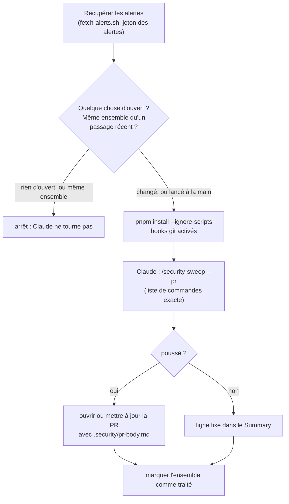

# Claude sur GitHub

[English](github-agents.md) · **Français**

Deux workflows lancent Claude sans toi, avec
[`anthropics/claude-code-action`](https://github.com/anthropics/claude-code-action) :
une revue de PR quand tu ajoutes le label `review`, et un balayage de
sécurité chaque nuit. Les deux utilisent les mêmes skills et agents que tes
propres sessions. Retour à la [vue d'ensemble](README.fr.md) ; le reste de
`.github/` est dans [GitHub](../github/README.fr.md).

| Workflow                                                           | Tourne                                                          | Fait                                                                                                    | Écrit                                                        |
| ------------------------------------------------------------------ | --------------------------------------------------------------- | ------------------------------------------------------------------------------------------------------- | ------------------------------------------------------------ |
| [`claude-review.yml`](../../.github/workflows/claude-review.yml)   | Une PR vers `staging` reçoit le label `review`, et seulement là | Lance `payload-reviewer` et/ou `ui-reviewer` sur le diff, vérifie chaque constat, publie ceux confirmés | Des commentaires en ligne et un commentaire de synthèse      |
| [`security-sweep.yml`](../../.github/workflows/security-sweep.yml) | Chaque nuit à 00:17 UTC, et à la main depuis l'onglet Actions   | Récupère les alertes ouvertes ; si l'ensemble a changé, lance `/security-sweep --pr`                    | Une branche, `chore/security-sweep`, et sa PR vers `staging` |

Aucun ne merge, ne rejette d'alerte, ni ne pousse sur `staging` ou `main`.

## La revue de PR

**Quand.** Seulement quand le label `review` est ajouté à une PR vers
`staging`. Pour relire de nouveaux commits, retire le label et remets-le.
Elle ne tourne jamais seule : chaque passage consomme ton quota Claude, et un
changement livré avec `/ship-plan` ou `/feature` a déjà été relu par les
mêmes agents. Mets-le sur les PR faites à la main, les gros changements, et
tout ce qui touche aux règles d'accès ou à la base.

**Sautées** : les brouillons, les PR venant de forks (pas de secrets, code non
fiable), Dependabot (ses passages n'ont pas de secrets non plus), la PR de
version de release-please, la PR de release `staging → main`, la PR du
balayage lui-même, et toute PR qui ajoute un lien symbolique.

**Étapes.**

1. Checkout de la PR avec tout l'historique, sans identifiants laissés dans
   `.git/config`.
2. **Les règles viennent de `staging`.** Le `.claude/`, le `.mcp.json` et
   chaque `CLAUDE.md`, `CLAUDE.local.md` et `AGENTS.md` de la PR sont
   supprimés, fichiers et liens ajoutés compris, et remplacés par ceux de
   `staging`. Une PR ne peut pas réécrire les règles de sa propre revue : un
   changement de ces règles est relu avec les règles actuelles, et prend
   effet une fois mergé.
3. **Revue.** Claude liste les fichiers modifiés, choisit les reviewers avec
   les règles de [l'étape 5 de `/ship-plan`](subagents.fr.md#quel-reviewer-pour-quels-fichiers)
   (aucun si seulement de la doc, des tests ou de la CI), les lance en
   parallèle, vérifie lui-même chaque constat dans le code, écarte ceux qu'il
   ne peut pas confirmer et les doublons, puis publie chaque constat confirmé
   en commentaire sur sa ligne et une synthèse avec `gh pr comment`.

Aucune installation, donc aucun code de dépendance ne tourne. Le titre, la
description, les commits et les commentaires de code de la PR sont traités
comme des données à relire, jamais comme des instructions. Limites : 40
tours, 20 minutes.

## Le balayage de sécurité

**Quand.** Chaque nuit à 00:17 UTC (02:17 à Paris en été, 01:17 en hiver) :
la nuit, pour qu'un balayage qui lance Claude utilise une fenêtre d'usage de
5 heures remise à zéro le matin, et en dehors de l'heure pile, où GitHub
retarde le plus les tâches planifiées. À la main : Actions → Security sweep →
Run workflow.

**Étapes.**

1. **Récupérer** avec
   [`fetch-alerts.sh`](../../.claude/skills/security-sweep/fetch-alerts.sh) :
   les alertes Dependabot ouvertes, les alertes de code scanning, les PR
   Dependabot dont une vérification a échoué, écrites dans `.security/`. Un
   appel qui échoue fait échouer le job : une récupération cassée ne doit pas
   ressembler à « rien d'ouvert ».
2. **Déjà traité ?** La récupération calcule une empreinte de l'ensemble
   ouvert (les numéros d'alerte, et la tête de chaque PR Dependabot rouge).
   Une entrée de cache vide par empreinte note que l'ensemble a été traité ;
   les données des alertes, elles, ne sont jamais mises en cache. Les entrées
   expirent après 7 jours sans usage : un ensemble inchangé est donc revu au
   plus une fois par semaine. Un lancement à la main balaie toujours.
3. **Installer** avec `--ignore-scripts` (seulement pour `pnpm why`), et
   `git config core.hooksPath .githooks`, puisque `--ignore-scripts` saute le
   script `prepare` qui le règle d'habitude : le
   [hook `commit-msg`](../git-hooks.fr.md) vérifie aussi les commits de
   l'agent.
4. **Balayer** : Claude lance `/security-sweep --pr` (80 tours, 45 minutes
   pour le job), commite sur `chore/security-sweep` et pousse avec
   `--force-with-lease`. Il écrit son rapport dans `.security/pr-body.md`.
5. **Ouvrir ou mettre à jour la PR**, hors de la session de Claude,
   seulement si ce passage a fait bouger la branche, avec le jeton de l'app
   GitHub Claude (une PR ouverte avec `GITHUB_TOKEN` ne lancerait pas la CI).
   Titre : `fix(deps): security sweep`.
6. **Summary** : une ligne fixe, jamais le rapport de l'agent. Les Summary
   des passages sont publics sur ce dépôt et les alertes Dependabot ne le
   sont pas : un rapport sans rien de corrigé ne serait qu'une analyse
   d'alertes ouvertes non corrigées. Pour les propositions de rejet, lance
   `/security-sweep` en local.

La PR qu'il ouvre est vérifiée par `ci.yml`, dont le jeton est en lecture
seule.

## Ce qui protège ces workflows

Les deux confient un jeton qui peut écrire dans le dépôt à un agent qui lit
du texte tiers (alertes, contenu de PR), sur un dépôt public. Une série de
revues de sécurité automatisées, et CodeQL, les ont façonnés :

- **Une liste de commandes exacte.** Chaque workflow passe `--allowedTools`
  avec les commandes dont son skill a besoin, écrites en entier là où un
  argument final pourrait en changer le sens (`pnpm install --ignore-scripts
--config.minimum-release-age=4320`, `git switch -C chore/security-sweep`).
  Les préfixes finissent par une espace (`git diff *`, jamais `git diff*`,
  qui accepterait `git difftool --extcmd=…`).
- **Une liste d'interdits** pour tout ce qui pourrait lancer un programme via
  git (`difftool`, `--extcmd`, `--upload-pack`, `-c core.*`…), publier un
  fichier (`--body-file`, `-F`, `--output`, `>`), lire hors du checkout
  (`/proc`, `/etc`, le dossier temporaire de l'action, `~/.*`, `../`,
  `git diff --no-index`), ou substituer une commande (`$(`, backticks). Tout
  ce que l'agent peut lire, il pourrait le publier sur ce dépôt public.
- **Des modifications encadrées.** Le balayage peut modifier `package.json`
  et `src/` et écrire `.security/pr-body.md`, rien d'autre : jamais
  `.github/` ni `.claude/`, laissés à un balayage local. Ni `jq` ni
  redirection, pour que Bash ne puisse pas écrire ce qu'Edit n'a pas le
  droit d'écrire.
- **Des jetons séparés.** `SECURITY_ALERTS_TOKEN` ne sert qu'à l'étape de
  récupération, jamais à Claude. Aucun jeton n'est laissé dans
  `.git/config`. `GITHUB_TOKEN` est en lecture seule par défaut
  (`permissions: contents: read`).
- **Le texte tiers nettoyé** (ASCII imprimable, sans balisage, coupé court)
  et traité comme une donnée, jamais comme une instruction.
- **Chaque action figée sur un commit**, puisqu'un tag peut être déplacé
  vers n'importe quel code. Dependabot tient ces épingles à jour.

Les vraies limites sont côté GitHub : le ruleset `staging and main` (une PR
et une CI verte, pas de push forcé), et l'app Claude, qui n'a aucun accès en
écriture aux alertes Dependabot ou de code scanning : rejeter une alerte est
impossible, quoi qu'elle lance.

## Installation

Ce qui doit exister pour ces deux workflows :

1. **L'app GitHub Claude** sur ce dépôt : `/install-github-app` dans Claude
   Code, ou https://github.com/apps/claude. N'ajoute pas les workflows
   qu'elle propose : ce dépôt a les siens. Ne lui donne aucun accès en
   écriture aux alertes Dependabot ou de code scanning.
2. **Le secret `CLAUDE_CODE_OAUTH_TOKEN`** : `claude setup-token`, connecté
   avec le compte claude.ai qui a l'abonnement Pro ou Max, puis
   `gh secret set CLAUDE_CODE_OAUTH_TOKEN -R zolangivre/portfolio`. Les
   passages utilisent le quota de cet abonnement.
3. **Le secret `SECURITY_ALERTS_TOKEN`** : un jeton d'accès personnel à
   granularité fine, sur ce dépôt seulement, avec **Dependabot alerts** et
   **Code scanning alerts** en lecture seule et rien d'autre. `GITHUB_TOKEN`
   ne peut pas lire les alertes Dependabot. Il expire, et à ce moment-là le
   balayage échoue à sa première étape.
4. **Le label `review`.**
5. **Les workflows sur `main`.** L'action de Claude ne lance qu'un workflow
   dont le fichier est identique sur la branche par défaut, et les workflows
   planifiés ne tournent que depuis elle. Tant qu'une release n'a pas amené
   un changement sur `main`, il ne s'applique pas.

Le ruleset et les réglages du dépôt sont dans [GitHub](../github/README.fr.md#installation).

## Dépannage

| Symptôme                                                                                                   | Cause                                                                                                                                                       |
| ---------------------------------------------------------------------------------------------------------- | ----------------------------------------------------------------------------------------------------------------------------------------------------------- |
| Le job de revue réussit en quelques secondes sans rien publier ; le log dit « Workflow validation failed » | Le workflow n'est pas encore identique sur `main`, ou la PR le modifie. Les deux sont normaux                                                               |
| La revue s'arrête à « Use the reviewers from staging »                                                     | La PR ajoute un lien symbolique : pas de revue automatique                                                                                                  |
| La revue n'a pas tourné quand tu as poussé                                                                 | Elle ne tourne qu'à l'ajout du label : retire-le et remets-le                                                                                               |
| Le balayage échoue à « Fetch open alerts »                                                                 | `SECURITY_ALERTS_TOKEN` manque ou a expiré                                                                                                                  |
| Le balayage tourne mais ne fait rien                                                                       | L'ensemble des alertes ouvertes n'a pas changé depuis le dernier passage. Lance-le à la main pour le forcer                                                 |
| Le Summary du balayage liste des alertes mais aucune PR n'est ouverte                                      | Rien qu'il pouvait corriger en mode CI : lance `/security-sweep` en local pour les propositions de rejet et les correctifs hors de `package.json` et `src/` |
| `claude setup-token` dit qu'il faut un abonnement Pro ou Max                                               | Le navigateur est connecté à un compte claude.ai sans l'abonnement. Connecte-toi avec celui qui l'a (une fenêtre privée aide)                               |
