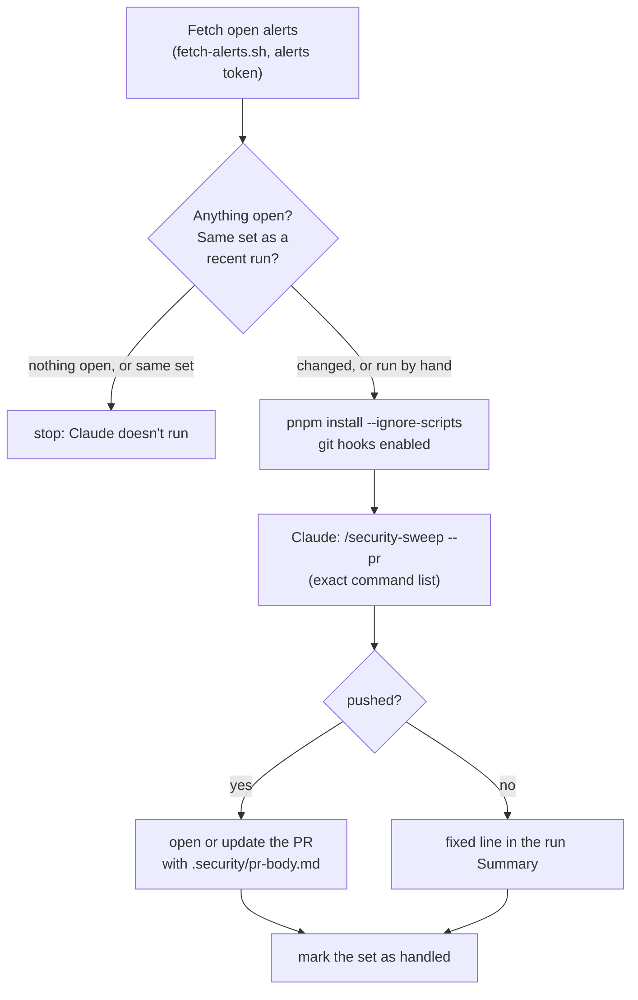

# Claude on GitHub

**English** · [Français](github-agents.fr.md)

Two workflows run Claude without you, with
[`anthropics/claude-code-action`](https://github.com/anthropics/claude-code-action):
a review of a PR when you add the `review` label, and a nightly security
sweep. Both use the same skills and agents as your own sessions. Back to the
[overview](README.md); the rest of `.github/` is in [GitHub](../github/README.md).

| Workflow                                                           | Runs                                                       | Does                                                                                                    | Writes                                                        |
| ------------------------------------------------------------------ | ---------------------------------------------------------- | ------------------------------------------------------------------------------------------------------- | ------------------------------------------------------------- |
| [`claude-review.yml`](../../.github/workflows/claude-review.yml)   | A PR into `staging` gets the `review` label, and only then | Runs `payload-reviewer` and/or `ui-reviewer` on the diff, checks each finding, posts the confirmed ones | Inline comments and one summary comment                       |
| [`security-sweep.yml`](../../.github/workflows/security-sweep.yml) | Nightly at 00:17 UTC, and by hand from the Actions tab     | Fetches the open alerts; if the set changed, runs `/security-sweep --pr`                                | One branch, `chore/security-sweep`, and its PR into `staging` |

Neither merges, dismisses an alert, or pushes to `staging` or `main`.

## The PR review

**When.** Only when the `review` label is added to a PR into `staging`. To
review new commits, remove the label and add it again. It never runs on its
own: each run uses your Claude quota, and a change shipped with `/ship-plan`
or `/feature` was already reviewed by the same agents. Add it to PRs made by
hand, big changes, and anything touching access rules or the database.

**Skipped**: drafts, PRs from forks (no secrets, untrusted code), Dependabot
(its runs get no secrets either), release-please's version PR, the
`staging → main` release PR, the sweep's own PR, and any PR that adds a
symlink.

**Steps.**

1. Checkout of the PR with full history, no credentials left in `.git/config`.
2. **Rules from `staging`.** The PR's `.claude/`, `.mcp.json`, and every
   `CLAUDE.md`, `CLAUDE.local.md` and `AGENTS.md` are deleted, files and links
   it added included, and replaced by `staging`'s. A PR can't rewrite the
   rules of its own review: a change to them is reviewed with the current
   rules, and takes effect once merged.
3. **Review.** Claude lists the changed files, picks the reviewers with the
   rules of [`/ship-plan` step 5](subagents.md#which-reviewer-for-which-files)
   (none for docs, tests or CI only), launches them in parallel, checks every
   finding against the code itself, drops what it can't confirm and the
   duplicates, then posts each confirmed finding as an inline comment and one
   summary with `gh pr comment`.

No install, so no dependency code runs. The PR title, description, commits
and code comments are treated as data to review, never as instructions.
Limits: 40 turns, 20 minutes.

## The security sweep

**When.** Every night at 00:17 UTC (02:17 in Paris in summer, 01:17 in
winter): at night, so a sweep that runs Claude uses a 5-hour usage window
that has reset by morning, and off the hour, where GitHub delays scheduled
runs the most. By hand: Actions → Security sweep → Run workflow.

**Steps.**

1. **Fetch** with
   [`fetch-alerts.sh`](../../.claude/skills/security-sweep/fetch-alerts.sh):
   open Dependabot alerts, code scanning alerts, Dependabot PRs with a failed
   check, written to `.security/`. A failed call fails the job: a broken fetch
   must not look like "nothing open".
2. **Already handled?** The fetch fingerprints the open set (alert numbers,
   and the head of each red Dependabot PR). An empty cache entry per
   fingerprint records that the set was handled; the alert data itself is
   never cached. Entries expire after 7 days unused, so an unchanged set is
   looked at again at most once a week. A manual run always sweeps.
3. **Install** with `--ignore-scripts` (for `pnpm why` only), and
   `git config core.hooksPath .githooks`, since `--ignore-scripts` skips the
   `prepare` script that normally sets it: the
   [`commit-msg` hook](../git-hooks.md) checks the agent's commits too.
4. **Sweep**: Claude runs `/security-sweep --pr` (80 turns, 45 minutes for the
   job), commits on `chore/security-sweep` and pushes with
   `--force-with-lease`. It writes its report to `.security/pr-body.md`.
5. **Open or update the PR**, outside Claude's session, only if this run
   moved the branch, with the Claude GitHub App's token (a PR opened with
   `GITHUB_TOKEN` wouldn't trigger CI). Title: `fix(deps): security sweep`.
6. **Summary**: a fixed line, never the agent's report. Run summaries are
   public on this repository and Dependabot alerts aren't: a report with
   nothing fixed would only be analysis of open, unpatched alerts. For the
   dismissal proposals, run `/security-sweep` locally.

The PR it opens is verified by `ci.yml`, whose token is read-only.

## What protects these workflows

Both hand a token that can write to the repo to an agent that reads
third-party text (alerts, PR content), on a public repository. A series of
automated security reviews, and CodeQL, shaped them:

- **An exact command list.** Each workflow passes `--allowedTools` with the
  commands its skill needs, written out in full where a trailing argument
  could change the meaning (`pnpm install --ignore-scripts
--config.minimum-release-age=4320`, `git switch -C chore/security-sweep`).
  Prefixes end with a space (`git diff *`, never `git diff*`, which would
  match `git difftool --extcmd=…`).
- **A deny list** for everything that could run a program through git
  (`difftool`, `--extcmd`, `--upload-pack`, `-c core.*`…), publish a file
  (`--body-file`, `-F`, `--output`, `>`), read outside the checkout
  (`/proc`, `/etc`, the action's temp directory, `~/.*`, `../`,
  `git diff --no-index`), or substitute a command (`$(`, backticks). Anything
  the agent can read, it could post on this public repository.
- **Edits fenced.** The sweep may edit `package.json` and `src/` and write
  `.security/pr-body.md`, nothing else: never `.github/` or `.claude/`, which
  are left for a local sweep. No `jq` or redirection, so Bash can't write
  what Edit may not.
- **Tokens kept apart.** `SECURITY_ALERTS_TOKEN` is only used by the fetch
  step, never by Claude. No token is left in `.git/config`.
  `GITHUB_TOKEN` is read-only by default (`permissions: contents: read`).
- **Third-party text cleaned** (printable ASCII, no markup, cut short) and
  treated as data, never as instructions.
- **Every action pinned to a commit**, since a tag can be moved to any code.
  Dependabot keeps the pins current.

The real limits are on GitHub's side: the `staging and main` ruleset (a PR
and green CI, no force push), and the Claude App, which has no write access
to Dependabot or code scanning alerts, so dismissing one is impossible
whatever it runs.

## Setup

What has to exist for these two workflows:

1. **The Claude GitHub App** on this repository: `/install-github-app` in
   Claude Code, or https://github.com/apps/claude. Don't add the workflows it
   offers: this repo has its own. Give it no write access to Dependabot or
   code scanning alerts.
2. **Secret `CLAUDE_CODE_OAUTH_TOKEN`**: `claude setup-token`, signed in with
   the claude.ai account that has the Pro or Max subscription, then
   `gh secret set CLAUDE_CODE_OAUTH_TOKEN -R zolangivre/portfolio`. Runs use
   that subscription's quota.
3. **Secret `SECURITY_ALERTS_TOKEN`**: a fine-grained personal access token on
   this repository only, with **Dependabot alerts** and **Code scanning
   alerts** read-only and nothing else. `GITHUB_TOKEN` can't read Dependabot
   alerts. It expires, and when it does the sweep fails at its first step.
4. **The `review` label.**
5. **The workflows on `main`.** Claude's action only runs a workflow whose
   file is identical on the default branch, and scheduled workflows only run
   from it. Until a release brings a change to `main`, it doesn't apply.

The ruleset and the repository settings are in [GitHub](../github/README.md#setup).

## Troubleshooting

| Symptom                                                                                         | Cause                                                                                                                                      |
| ----------------------------------------------------------------------------------------------- | ------------------------------------------------------------------------------------------------------------------------------------------ |
| The review job succeeds in seconds and posts nothing; the log says "Workflow validation failed" | The workflow isn't identical on `main` yet, or the PR modifies it. Both are expected                                                       |
| The review stops at "Use the reviewers from staging"                                            | The PR adds a symlink: not reviewed automatically                                                                                          |
| The review didn't run when you pushed                                                           | It only runs when the label is added: remove it and add it again                                                                           |
| The sweep fails at "Fetch open alerts"                                                          | `SECURITY_ALERTS_TOKEN` is missing or expired                                                                                              |
| The sweep runs but does nothing                                                                 | The set of open alerts hasn't changed since the last run. Run it by hand to force it                                                       |
| The sweep's Summary lists alerts but no PR opened                                               | Nothing it could fix in CI mode: run `/security-sweep` locally for the dismissal proposals and the fixes outside `package.json` and `src/` |
| `claude setup-token` says a Pro or Max plan is needed                                           | The browser is signed in to a claude.ai account without the subscription. Sign in with the one that has it (a private window helps)        |
