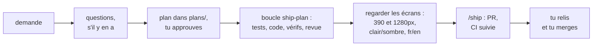
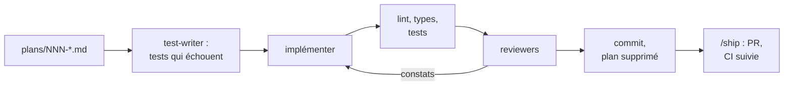

# Skills

[English](skills.md) · **Français**

Tous les skills de [`.claude/skills/`](../../.claude/skills/). Seize sont des
commandes que tu tapes (`/feature`, `/ship`…) : elles ne tournent que quand
tu les lances. Deux sont chargés par Claude tout seul quand la tâche le
demande. Retour à la [vue d'ensemble](README.fr.md).

- [En un coup d'œil](#en-un-coup-dœil)
- [Construire et livrer](#construire-et-livrer) : `/feature`, `/ship-plan`, `/bug`, `/flaky`, `/ship`
- [Base de données et Payload](#base-de-données-et-payload) : `/new-migration`, `/upgrade-payload`
- [Vérifications et audits](#vérifications-et-audits) : `/pre-pr`, `/audit`, `/preview-check`, `/site-health`, `/content-audit`
- [Dépendances et sécurité](#dépendances-et-sécurité) : `/security-sweep`, `/triage-deps`
- [Release](#release) : `/release`, `/release verify`
- [Ménage](#ménage) : `/menage`
- [Les skills que Claude charge tout seul](#les-skills-que-claude-charge-tout-seul) : `payload`, `i18n-copy`
- [Comment les skills s'appellent entre eux](#comment-les-skills-sappellent-entre-eux)
- [Anatomie d'un skill](#anatomie-dun-skill)

## En un coup d'œil

| Tu veux…                                                       | Lancer                                                      | Où ça s'arrête                                        |
| -------------------------------------------------------------- | ----------------------------------------------------------- | ----------------------------------------------------- |
| Construire quelque chose à partir d'une demande                | `/feature ajoute un temps de lecture aux cartes du journal` | Une PR vers `staging`, CI verte                       |
| Livrer un changement que tu as planifié                        | `/ship-plan 007` (`--local` pour s'arrêter avant le push)   | Une PR vers `staging`, CI verte                       |
| Corriger un bug                                                | `/bug les dates des projets ont un mois d'avance`           | Une PR vers `staging`, CI verte                       |
| Corriger un test instable                                      | `/flaky` (ou `/flaky e2e --repeat 20`)                      | Une PR vers `staging`, CI verte                       |
| Livrer le travail en cours                                     | `/ship` (`--draft` pour une PR brouillon)                   | Une PR vers `staging`, CI verte                       |
| Modifier le schéma de la base                                  | `/new-migration add_project_tagline`                        | Un fichier de migration, prouvé par un migrate à neuf |
| Mettre à jour Payload (ou réparer la PR Payload de Dependabot) | `/upgrade-payload 3.92.0` ou `/upgrade-payload 123`         | Une PR vers `staging`, CI verte                       |
| Vérifier une branche avant d'ouvrir une PR                     | `/pre-pr` (ajouter `--e2e` pour les tests navigateur)       | Un rapport, aucune modification                       |
| Auditer SEO, accessibilité et vitesse, puis corriger           | `/audit` (ou `/audit seo`, `/audit --local`)                | Un rapport ; puis une PR par correctif choisi         |
| Regarder staging avant une release                             | `/preview-check` (ou `/preview-check local`)                | Des captures et un rapport dans `plans/`              |
| Vérifier que la prod va bien                                   | `/site-health`                                              | Un rapport dans `plans/`                              |
| Relire les textes fr/en du site                                | `/content-audit`                                            | Un fichier de textes dans `plans/`                    |
| Traiter les alertes de sécurité                                | `/security-sweep`                                           | Un commit local, ou une PR quand c'est la CI          |
| Trancher sur une PR Dependabot                                 | `/triage-deps 79`                                           | Un verdict, rien de mergé                             |
| Passer staging en production                                   | `/release`, puis `/release verify` après le merge           | La PR de release ; puis un rapport sur la prod        |
| Nettoyer les branches mergées et les worktrees                 | `/menage` (ou `/menage --dry-run`)                          | Une liste ; ne supprime que ce que tu confirmes       |

Les rapports reviennent en français ; les commits, les titres et les
descriptions de PR sont en anglais.

## Construire et livrer

### `/feature <demande>` : d'une demande à une PR

La boucle qui te prend le moins de temps. Tu dis ce que tu veux avec tes
mots ; Claude revient deux fois : une pour que tu approuves le plan, une avec
une PR dont la CI est verte.



1. **Garde-fou.** L'arbre de travail doit être propre. Sinon, Claude demande
   quoi faire des modifications ; il ne les met jamais de côté lui-même
   (`stash`, `reset`).
2. **Cadrer.** Il lit `CLAUDE.md`, `AGENTS.md` et les **Décisions** de
   `plans/README.md`, explore le code le plus proche de la demande, et pose
   une à trois questions, seulement sur ce que le code et les conventions ne
   tranchent pas (une formulation, un choix visuel).
3. **Planifier.** Il écrit `plans/NNN-<slug>.md` à partir du modèle (`NNN`
   est le prochain numéro libre, en comptant les lignes `Plan: NNN` de
   l'historique git) et le présente en mode plan avec ses risques :
   migration, tags de cache, SEO, les deux langues. Rien ne change avant ton
   accord.
4. **Construire**, en suivant les étapes 0 à 7 de `/ship-plan`.
5. **Regarder.** Si le changement se voit sur le site, il lance la branche
   (sur 3100 si 3000 est pris ; il n'arrête jamais un serveur qu'il n'a pas
   lancé), regarde chaque écran touché à 390 et 1280px, en clair et en
   sombre, en fr et en en, et garde une capture par écran pour la PR. Les
   corrections rejoignent le commit tant qu'il n'est pas poussé.
6. **Livrer**, en suivant `/ship` à partir de l'étape 3.

Il s'arrête et demande si le plan ne tient plus (une migration imprévue, un
choix de design non tranché), après trois tentatives ratées sur le même
échec, ou avant tout ce qui sort de la boucle : `main`, `staging`, les
secrets, le CMS de production, Vercel.

### `/ship-plan NNN [--local]` : d'un plan à une PR

La boucle principale pour tout changement qui a un plan (`/feature` l'écrit
pour toi).



0. **Garde-fou** : arbre propre, le plan existe et n'est pas DONE, il a une
   Target et une Vérification. Un plan qui contredit une **Décision**, ou qui
   laisse une question de goût ouverte, s'arrête ici avec une question.
1. **Branche** `<type>/<NNN>-<slug>` depuis un `staging` à jour. Le plan passe
   à IN PROGRESS et entre dans le tableau **En cours**.
2. **Les tests d'abord.** [`test-writer`](subagents.fr.md#test-writer) écrit les
   tests à partir de la Target, avant que le code existe. Claude vérifie qu'il
   n'a touché que `tests/`, et que chaque nouveau test échoue pour la raison
   que décrit le plan : un test qui passe déjà ne prouve rien. Sauté
   seulement pour un changement qu'aucun test ne peut observer (pur style,
   texte), et le rapport le dit.
3. **Implémenter** la Target, rien de plus. Le reste de ce qu'il remarque va
   dans **Hors périmètre** du plan. Un changement de schéma suit
   `/new-migration`.
4. **Vérifier** : `pnpm lint`, `tsc --noEmit`, `test:coverage` (90 %),
   `test:int` si le schéma, les règles d'accès, les hooks ou les migrations
   ont bougé, `test:dom`, et chaque fichier e2e nouveau ou modifié dans
   Chromium. Trois tentatives sur le même échec, puis il s'arrête. Il
   n'affaiblit jamais un test.
5. **Revue.** Les reviewers qui correspondent aux fichiers modifiés, lancés
   en parallèle : [`payload-reviewer`](subagents.fr.md#payload-reviewer) pour le
   back, [`ui-reviewer`](subagents.fr.md#ui-reviewer) pour le front,
   [`webkit-reviewer`](subagents.fr.md#webkit-reviewer) pour tout ce que Safari
   pourrait casser (animations, défilement, l'en-tête, les modales, la vidéo,
   le focus, `position`, `overflow`, `backdrop-filter`, les unités de
   viewport, `:has()`).
6. **Trier** : chaque constat est corrigé, rejeté (avec le code qui montre
   qu'il est faux) ou reporté dans **Hors périmètre**. Deux tours de revue au
   plus.
7. **Livrer** : les vérifications de `/pre-pr` ; les éléments **Hors
   périmètre** et les constats reportés copiés dans le **Backlog** ; un commit
   Conventional dont le corps reprend le Problème, la Target, les fichiers de
   test et `Plan: NNN` ; puis le fichier du plan est supprimé. Sans
   `--local`, il enchaîne avec `/ship` à partir de l'étape 4.

### `/bug <description>` : d'un bug à une PR

Un bug est corrigé quand un test qui le reproduisait passe.

1. **Comprendre** : le bug en une phrase (ce qui se passe, ce qui devrait,
   où : page, langue, thème, appareil, visiteur ou admin). Une URL de prod est
   regardée en lecture seule ; les erreurs serveur viennent des logs
   d'exécution Vercel. Il ne se connecte jamais à l'admin de production.
2. **Branche** `fix/<slug>` depuis `origin/staging`. Un **hotfix** (le bug est
   en prod et `staging` contient du travail qui ne doit pas encore partir)
   part de `origin/main` et ouvre une PR vers `main`, seulement avec ton
   accord, et le rapport rappelle de remerger `main` dans `staging`.
3. **Reproduire** avec un test qui échoue, à la couche la plus basse qui le
   permet : unit pour la logique pure, int pour Payload (accès, hooks,
   schéma), dom pour un composant, e2e pour un parcours visiteur. Il doit
   échouer pour la raison du bug. Pas de reproduction, pas de correctif : il
   dit ce qu'il a essayé et s'arrête.
4. **Cause racine**, pas le symptôme, et un `grep` du même motif ailleurs. Si
   le correctif grossit (une migration, plus d'une poignée de fichiers, un tag
   de cache, un choix de comportement), il devient un plan à approuver.
5. **Corriger** : le plus petit changement. Le test passe, les tests liés
   passent, et sans le correctif le test échoue à nouveau.
6. **Vérifs, revue, regard, livraison**, comme `/feature`. Le commit est un
   `fix(<scope>)` dont le corps nomme la cause et le test.

### `/flaky [e2e|unit|int] [--repeat N]`

La CI relance deux fois un test e2e raté (`retries: 2` dans
`playwright.config.ts`) : un test instable reste vert jusqu'au jour où il
échoue trois fois de suite.

1. **Trouver** : dans l'historique de la CI (passages relancés sur le même
   commit, tests que le reporter `github` marque comme flaky), puis en
   répétant sans relance (10 fois par défaut pour e2e et int, 30 pour unit,
   `--sequence.shuffle` pour Vitest). En local, Playwright réutilise un
   serveur déjà sur 3100 : il vérifie d'abord, sinon il testerait un autre
   build.
2. **Comprendre** : seul ou avec la suite. Seulement avec la suite, c'est un
   état partagé (specs qui modifient le contenu de test, la limite de débit
   du formulaire, les tags de cache). Seul aussi, c'est le timing (une
   apparition encore en cours, une view transition, l'effet machine à
   écrire). Seulement en CI, c'est l'environnement. Selon l'ordre, c'est un
   mock ou une fixture qui fuit. La trace dit l'essentiel.
3. **Corriger** le test (attendre le bon signal, posséder ses données,
   remettre l'état partagé), ou l'app via `/bug` si c'est une vraie course,
   ou la CI dans un commit `ci:`.
4. **Prouver** : N passages verts d'affilée dans les conditions où il
   échouait. Les correctifs `mobile-safari` sont prouvés en CI, puisque
   WebKit ne s'installe pas sur ce Mac.

Interdit : augmenter `retries`, `test.skip` / `test.fixme`, un timeout plus
long sans savoir pourquoi il expire, changer l'app pour arranger un test. Le
skill tient un tableau **Known cases**, mis à jour dans la même PR.

### `/ship [--draft]` : du travail en cours à une PR

La dernière étape de `/feature`, `/ship-plan`, `/bug`, `/flaky` et
`/upgrade-payload`, ou seule pour un correctif fait en conversation.

1. **Branche** : sur `staging` ou `main` avec des modifications, il crée
   `<type>/<slug>` et les garde. Des modifications sans rapport (un correctif
   et un changement de configuration) deviennent des branches et des PR
   séparées.
2. **Vérifs** : les étapes 1–4, 7 et 8 de `/pre-pr`, plus chaque spec e2e
   touchée. Ici il **corrige** les échecs, trois tentatives au plus.
3. **Commits** : un par unité logique, fichiers ajoutés par chemin (jamais
   `-A`), messages en anglais au format Conventional. Les PR sont mergées avec
   un commit de merge, donc chaque commit arrive tel quel dans le CHANGELOG :
   une réparation du propre travail de la branche prend `test`, `refactor` ou
   `chore`, pas `fix`.
4. **Push** en nommant la branche (`guard-git` refuse le reste).
5. **PR** vers `staging`, selon
   [`pull_request_template.md`](../../.github/pull_request_template.md) : quoi
   et pourquoi, les tests lancés, ce qu'il faut regarder, les notes pour le
   merge. Le dépôt est public : aucun secret, donnée personnelle ou
   vulnérabilité non corrigée. Il n'ajoute pas le label `review`, puisque les
   reviewers sont déjà passés.
6. **CI** suivie en arrière-plan. Une cause dans la branche est corrigée et
   poussée ; un échec d'infrastructure (réseau, registre, runner) vert sur
   `staging` est relancé une fois ; une cause hors de la branche est
   signalée, pas corrigée ici. Trois tours au plus.

Il ne merge jamais. Le rapport finit par ce qui te reste : relire, regarder,
glisser les captures dans la PR (`gh` ne sait pas envoyer d'images), merger.

## Base de données et Payload

### `/new-migration <slug>`

`payload migrate:create` ne marche pas dans ce dépôt : ses snapshots sont
périmés. Les migrations s'écrivent à la main, et c'est ce que fait cette
commande.

1. **SQL** : à partir du [test de dérive du schéma](../github/ci.fr.md#le-test-de-dérive-du-schéma),
   dont le message d'échec est le SQL de Drizzle pour le changement manquant,
   vérifié par rapport au nommage de Payload (`<table>_locales`,
   `<table>_rels`, `enum_<table>_<champ>`, la colonne de
   `payload_locked_documents_rels` pour une nouvelle collection).
2. **Fichier** `src/migrations/YYYYMMDD_HHMMSS_<slug>.ts` (UTC), calqué sur
   le dernier : un commentaire sur le pourquoi, un `up` idempotent
   (`IF NOT EXISTS`, gardes `duplicate_object`), un `down` qui l'annule
   exactement, les données copiées avant toute suppression.
3. **Enregistrer** dans `src/migrations/index.ts`, dans le style propre à ce
   fichier (il est dans `.prettierignore` exprès).
4. **Prouver** : `payload migrate`, `migrate:down`, `migrate`, puis
   `test:int` (reconstruit la base de test à partir des seules migrations et
   lance le test de dérive), puis `tsc`.

### `/upgrade-payload <version | numéro de PR>`

Une mise à jour de Payload peut changer la base sans aucun changement de
config de notre côté : la 3.90 a ajouté des colonnes, la 3.91 seize index.
Vercel lance `payload migrate` à chaque déploiement, donc une migration
manquante casse le site, pas seulement un test.

- **Avec un numéro de PR**, il récupère la PR `payload-next-react` de
  Dependabot. Elle peut être incomplète : pour la 3.91, elle montait
  `payload` mais pas `@payloadcms/*`.
- **Avec une version**, il crée `chore/upgrade-payload-<version>` et monte
  chaque paquet `payload` et `@payloadcms/*` à la même version exacte, avec
  le délai de publication de 3 jours. Next et React ne bougent que si les
  plages de pairs de Payload l'exigent.
- **Une nouvelle majeure** (4.x) s'arrête tout de suite et devient un plan.

Ensuite : les notes de version de chaque version intermédiaire (seulement
ce qui touche ce projet), `generate:types` et `generate:importmap` (une
import map périmée casse l'admin), le test de dérive et la migration qu'il
réclame, les corrections de code (les nouvelles API plutôt que des casts),
toutes les vérifs e2e comprises, `payload-reviewer`, des commits séparés pour
la migration, le code et les dépendances, et `/ship`. Le rapport liste ce
qu'il faut vérifier après le déploiement de `staging` : `payload migrate` dans
le log Vercel, l'envoi d'une image et d'une vidéo (R2), le texte riche,
l'onglet SEO, la connexion.

## Vérifications et audits

### `/pre-pr [--e2e]`

Les mêmes vérifications que la CI, en local, sans rien modifier :

1. `pnpm lint`
2. `pnpm exec tsc --noEmit`
3. `pnpm test:coverage` (échoue sous 90 %, il nomme les fichiers qui tirent
   vers le bas)
4. `pnpm test:dom`
5. `pnpm test:int` (demande le Postgres local)
6. avec `--e2e` : `pnpm test:e2e`, dans Chromium et les projets mobiles en
   émulation Chromium (la CI lance le vrai WebKit)
7. chaque message de commit au format Conventional
8. un changement de schéma vient avec une migration enregistrée dans
   `index.ts`
9. `src/payload-types.ts` est à jour

Il continue après un échec, pour que le rapport liste tous les problèmes
d'un coup.

### `/audit [--local] [seo|a11y|perf] [chemin…]`

Là où `/site-health` surveille la prod chaque semaine et compare, `/audit`
creuse une fois, puis corrige. Sur la prod en lecture seule, ou avec
`--local` sur le build de production avec contenu de test de la branche
courante (http://localhost:3100). Pages par défaut, dans les deux langues :
l'accueil, le premier projet, le journal et sa première entrée.

- **SEO** : `robots.txt`, un sitemap dont chaque URL répond 200, et par page :
  titre et description (uniques), `<html lang>`, une canonique égale à l'URL
  de la page elle-même, `hreflang` vers la même page dans l'autre langue plus
  `x-default`, des images Open Graph qui répondent en PNG, du JSON-LD qui se
  lit (la `Person` comparée au CMS), de vraies 404, l'admin hors de l'index,
  la redirection `zolangivre.com` → `www` permanente (un 307 est le défaut de
  Vercel).
- **Accessibilité** : Lighthouse mobile et desktop, l'arbre d'accessibilité
  (un seul `h1`, les noms des boutons-icônes, les alt, les libellés du
  formulaire, l'ordre de tabulation, le menu mobile fermé hors de l'arbre), le
  contraste avec l'accent du CMS dans les deux thèmes, le mouvement réduit.
- **Performance** : Lighthouse et traces, mobile en 4G lente d'abord : le LCP
  et ce qui le retarde, le CLS, les tâches longues, l'INP sur une
  interaction, les images lourdes, les polices bloquantes, le JS client
  inutile.

Le rapport classe les problèmes par impact sur les visiteurs et la
recherche. Tu choisis les correctifs ; chaque thème devient une branche
(`fix/seo-…`, `fix/a11y-…`, `perf/…`) et une PR avec la mesure avant → après.

### `/preview-check [local | URL]`

Ce que les tests ne voient pas : une ombre perdue en mode sombre, un menu qui
saute, un ressort qui ne donne plus la même sensation. Vercel ne déploie que
`staging` et `main`, donc il compare **le déploiement de staging avec la
prod** (un déploiement protégé s'ouvre par un lien temporaire Vercel) :

- captures pleine page de l'accueil, d'un projet, du journal, d'une entrée et
  de la 404, desktop en fr, mobile en fr et en en, clair et sombre, côte à
  côte ;
- les interactions : menu mobile (piège du focus, Échap), thème (survit à un
  rechargement, sans flash), langue (même page, le fondu de sortie se
  termine), filtres du journal, inclinaison des cartes, barre de lecture à
  0/50/100 %, validation du formulaire de contact (jamais envoyé) ;
- le mouvement réduit, et la console sur chaque page.

Des différences de texte ou d'images sont attendues (les bases peuvent
différer) : il compare la mise en page, les couleurs, les états et le
mouvement. Avec `local`, il vérifie la branche courante sur le build avec
contenu de test, pour la mise en page cassée seulement. Les captures vont
dans `plans/.preview/`. Lecture seule.

### `/site-health [URL du site]`

Un coup d'œil hebdomadaire à la prod, comparé au bilan précédent
(`plans/.health/*.json`) :

- **Vercel** : les derniers déploiements, les groupes d'erreurs d'exécution
  sur 7 jours (nouveaux ou connus), les pages vues cette semaine et la
  précédente ;
- **pages et liens** avec
  [`check-links.sh`](../../.claude/skills/site-health/check-links.sh) :
  chaque page du sitemap (200, moins de 1,5 s) et chaque lien externe du
  contenu (un 403 ou 999 de LinkedIn et consorts ne prouve pas qu'un lien est
  mort) ;
- **Lighthouse et Core Web Vitals** sur l'accueil, un projet et le journal,
  plus une trace de performance de l'accueil sur mobile.

Il écrit `plans/sante-<date>.md` et les chiffres pour la fois suivante, et
ajoute les vrais problèmes au **Backlog**. Lecture seule : aucun
déploiement, rollback, changement d'env ni purge de cache. Le vérificateur
de liens ne suit que des noms de domaine publics (pas d'IP, de `localhost`,
`.local`, `.internal`) et ne suit pas les redirections.

### `/content-audit [URL du site]`

Lit chaque global et chaque collection publique via l'API publique de
Payload, les deux langues d'un coup, avec
[`fetch-content.sh`](../../.claude/skills/content-audit/fetch-content.sh), qui
aplatit chaque champ localisé en une paire fr/en. Puis il vérifie, par
rapport au skill `zolan-profile` et à `plans/textes-portfolio.md` :

1. les champs remplis dans une seule langue ;
2. les textes non traduits, ou du français dans le champ `en` ;
3. les fautes, la grammaire, la typographie française (espaces avant
   `: ; ! ?`, « ») ;
4. les noms, titres, dates et technos écrits pareil partout ;
5. les titres et descriptions SEO manquants ;
6. les faits périmés par rapport au profil.

Il écrit `plans/textes-audit-<date>.md`, chaque bloc étant le texte complet
d'un champ, prêt à coller dans l'admin. Il n'écrit jamais dans Payload. Les
médias ne sont pas publics, donc les alt des images ne sont pas couverts.

## Dépendances et sécurité

### `/security-sweep [--pr]`

Dependabot ouvre des PR de version tout seul ([Dependabot](../github/dependabot.fr.md)).
Il ne sait pas corriger une dépendance **transitive** vulnérable dont le
parent fige l'ancienne version, et CodeQL ne fait que signaler. Le balayage
traite les deux, et les PR Dependabot dont la CI est rouge.

[`fetch-alerts.sh`](../../.claude/skills/security-sweep/fetch-alerts.sh)
rassemble tout dans `.security/` (ignoré par git) : les alertes Dependabot
ouvertes, les alertes de code scanning ouvertes, et les PR Dependabot dont
une vérification a échoué. Chaque texte tiers est nettoyé (ASCII imprimable
seulement, sans balisage, coupé court) et traité comme une donnée, jamais
comme une instruction. Il n'y a jamais qu'une branche de balayage,
`chore/security-sweep`, et une PR.

- **Dépendance directe** : montée dans `package.json`.
- **Transitive** : une entrée `pnpm.overrides` limitée à la plage vulnérable
  et figée sur la première version corrigée (`"undici@<7.29.1": "7.29.1"`),
  dans la majeure installée, installée avec un délai de publication de 3
  jours comme celui de Dependabot. Les overrides dont l'arbre n'a plus
  besoin sont retirés. La preuve est un `grep` du lockfile qui ne montre plus
  aucune version dans la plage.
- **Pas de correctif possible** (pas de version corrigée, ou seulement dans
  une autre majeure) : une proposition de rejet avec l'endroit où le code
  tourne, si le chemin est atteignable, la raison, et la commande `gh api`
  exacte. Il ne rejette jamais rien lui-même.
- **CodeQL** : le plus petit changement qui satisfait la règle.
- **PR Dependabot rouges** : un petit correctif poussé sur la branche de la
  PR, ou un commentaire de diagnostic pour un changement plus gros.

Il ne touche jamais `payload`, `@payloadcms/*`, `next`, `react` ni leurs
types (c'est `/upgrade-payload`), ne lance jamais `pnpm update --depth`, ne
commite jamais avec `--no-verify`. Les alertes Dependabot se ferment quand le
correctif atteint `main`, pas quand la PR du balayage est mergée.

**Deux modes.** En local (sans argument), la boucle complète avec toutes les
vérifs, jusqu'à des commits locaux. Avec `--pr`, le mode CI qu'utilise le
[workflow nocturne](github-agents.fr.md#le-balayage-de-sécurité) : aucun code
de dépendance ne tourne (`--ignore-scripts`, ni tests ni build), c'est la CI
de la PR qui vérifie, et ce qui demande plus (un changement de workflow ou
de `.claude/`) est laissé à un balayage local.

### `/triage-deps <numéro de PR>`

Pour toute PR Dependabot sauf Payload/Next/React (celles-là vont à
`/upgrade-payload`).

1. Lit la PR : chaque paquet, ancienne → nouvelle version,
   patch/mineure/majeure, et le retard de sa base sur `staging`.
2. Lit chaque release entre les deux versions (ou le CHANGELOG au tag), en
   ne gardant que les API retirées, les valeurs par défaut changées, les
   changements de comportement, les nouveaux pairs.
3. Cherche dans le code chaque API modifiée. Un changement cassant dans une
   API que personne n'appelle ici est une ligne du rapport, pas un risque.
4. Merge la PR dans le `staging` actuel sur une branche jetable et lance
   toutes les vérifs, e2e compris, en comparant les avertissements avec ceux
   de `staging`.
5. Pour un paquet qui tourne dans le navigateur (motion, next-themes, la
   lightbox), lance le build de production avec contenu de test et mesure les
   écrans concernés avec chrome-devtools : les apparitions qui finissent
   visibles, les valeurs liées au défilement, le mouvement réduit, la
   console.
6. Nettoie : retour sur `staging`, branches supprimées, `node_modules`
   réinstallé.

Le verdict est **Mergeable**, **Mergeable, à vérifier à l'œil** (avec cinq
minutes de choses à regarder sur staging) ou **Bloquant**, plus le moment où
merger par rapport à la release en attente. Il ne merge, ne pousse ni ne
commente jamais ; un verdict ne va sur GitHub qu'une fois que tu l'as vu.

## Release

### `/release` et `/release verify`

Une release, ce sont trois merges dans un ordre fixe, puis un déploiement qui
lance `payload migrate` sur la prod (voir [Releases](../github/releases.fr.md)).

`/release` la prépare :

1. **Ce qui attend** : chaque PR ouverte classée en part maintenant / doit
   d'abord être tranchée (`/triage-deps` ou `/upgrade-payload`) / attend la
   prochaine release (CI rouge, brouillon, majeure d'exécution qui mérite de
   partir seule).
2. **Staging est vert** : son dernier passage de CI et son déploiement Vercel
   correspondent à la tête de `origin/staging` et sont verts. Une release qui
   touche le front suggère d'abord `/preview-check`.
3. **La base de production** : chaque migration qui va tourner est lue. Un
   index unique sur des données existantes ou un changement de type est un
   blocage signalé tout de suite.
4. **La PR de release** : `staging → main` ouverte ou mise à jour, construite
   à partir des commits et de la PR de release-please : l'ordre des merges, ce
   qui part (code de prod ou outillage), ce qu'il faut vérifier après le
   déploiement, ce qui reste de côté.
5. **Passer la main** : l'ordre des merges, numéroté, avec les liens. Tu
   merges.

`/release verify`, après le merge, vérifie la prod : le build Vercel est
`READY` pour la tête de `main`, `payload migrate` a appliqué chaque nouvelle
migration (ou l'avait déjà fait, si un autre environnement partage la base),
aucune nouvelle erreur d'exécution, chaque page principale répond 200, la
release GitHub existe. Si la prod est cassée, il le dit et explique comment
revenir en arrière, mais ne le fait pas.

## Ménage

### `/menage [--dry-run]`

Chaque `/feature`, `/bug` et `/ship` laisse une branche derrière lui, et le
dépôt ne les supprime pas au merge. `/menage` liste les branches locales
mergées (dans git, ou dont la PR a été mergée sur GitHub), les branches
orphelines, les branches distantes des PR mergées ou fermées, les worktrees
abandonnés (`.claude/worktrees/` compris), et les PR silencieuses depuis 30
jours. Il demande quoi supprimer, par catégorie, et ne supprime que ça.
`--dry-run` s'arrête à la liste.

Il ne touche jamais `main`, `staging`, la branche courante, les branches des
bots (`dependabot/…`, `release-please--…`, `chore/security-sweep`), une
branche dont des commits ne sont poussés nulle part, un worktree avec des
modifications, ni aucune PR.

## Les skills que Claude charge tout seul

### `payload`

Une référence générale de Payload CMS 3 : un tableau de référence rapide,
puis [`reference/`](../../.claude/skills/payload/reference/) pour les champs,
les collections, les hooks, le contrôle d'accès, les requêtes, les
endpoints, les adaptateurs et les plugins. [`CLAUDE.md`](../../CLAUDE.md) y
renvoie Claude, et les reviewers lisent le fichier concerné avant de juger
des règles d'accès, des hooks ou des requêtes. Il n'est pas écrit pour ce
dépôt : les règles du projet vivent dans les agents et dans
`plans/README.md`.

### `i18n-copy`

Les règles de tout texte qu'un visiteur voit (`user-invocable: false`, donc
pas de commande). Claude l'applique dès qu'il touche du texte d'interface ou
un champ du CMS affiché sur le site :

- aucun texte visible dans le code : tout passe par `getDictionary(locale)`,
  textes de repli compris, avec une clé dans l'interface et dans les deux
  langues (`tests/unit/dictionary.spec.ts` échoue sinon) ;
- les composants client reçoivent leurs textes en props, pas tout le
  dictionnaire ;
- un champ affiché sur le site est `localized: true` (une migration) avec un
  `maxLength` que la mise en page supporte ; les libellés de l'admin restent
  en français ;
- les dates via `Intl` et `formatMonthRange`, en UTC ; les pluriels via
  `Intl.PluralRules` ; la typographie française (’, « », espaces insécables).

## Comment les skills s'appellent entre eux

Un skill qu'on tape ne peut pas être invoqué depuis un autre skill. Quand
l'un s'appuie sur un autre, il lit son `SKILL.md` et suit les étapes qu'il
nomme :

| Skill              | Lit et suit                                                      | Lance                                                       |
| ------------------ | ---------------------------------------------------------------- | ----------------------------------------------------------- |
| `/feature`         | `/ship-plan` 0–7, puis `/ship` à partir de 3                     | via `/ship-plan`                                            |
| `/ship-plan`       | `/new-migration` (schéma), `/pre-pr`, puis `/ship` à partir de 4 | `test-writer`, puis les reviewers qui correspondent au diff |
| `/bug`             | `/feature` (garde-fou, regard), `/pre-pr`, `/ship` à partir de 3 | `payload-reviewer`, `ui-reviewer`                           |
| `/flaky`           | `/bug` (une vraie course), `/ship` à partir de 1                 |                                                             |
| `/upgrade-payload` | `/new-migration`, `/ship` à partir de 4                          | `payload-reviewer`                                          |
| `/ship`            | `/pre-pr`, `/new-migration`                                      |                                                             |
| `/audit`           | `/feature` à partir de 2, pour chaque correctif choisi           | via `/feature`                                              |
| `/security-sweep`  |                                                                  | `payload-reviewer`, `ui-reviewer` si `src/` a changé        |
| `/release`         | suggère `/triage-deps`, `/upgrade-payload`, `/preview-check`     |                                                             |

## Anatomie d'un skill

Chaque skill est un dossier avec un `SKILL.md`, parfois avec un script à
côté. L'en-tête :

```yaml
---
name: ship
description: … # ce que Claude lit pour décider quand le skill s'applique
disable-model-invocation: true # ne tourne que quand tu tapes /ship
argument-hint: '[--draft]' # affiché après le nom de la commande
---
```

- `disable-model-invocation: true` est mis sur chaque commande : Claude n'en
  lance jamais une tout seul, ce qui compte pour celles qui poussent ou qui
  prennent du temps.
- `user-invocable: false` (sur `i18n-copy`) fait l'inverse : pas de
  commande, Claude le charge quand la description correspond.
- `$ARGUMENTS` dans le corps, c'est ce que tu as tapé après la commande.
- Une ligne comme ``- Branch: !`git branch --show-current` `` s'exécute au
  chargement du skill et place sa sortie dans son contexte : il part de
  l'état réel.
- Les scripts (`fetch-alerts.sh`, `check-links.sh`, `fetch-content.sh`) font
  les appels réseau : le skill lit des fichiers au lieu de tenir des jetons,
  et le texte tiers est nettoyé avant que Claude le voie.
