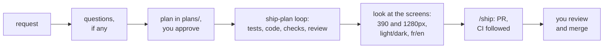
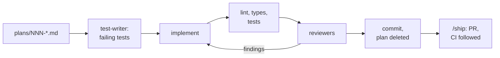

# Skills

**English** · [Français](skills.fr.md)

Every skill in [`.claude/skills/`](../../.claude/skills/). Sixteen are
commands you type (`/feature`, `/ship`…): they only run when you do. Three are
loaded by Claude on its own when the task calls for them. Back to the
[overview](README.md).

- [At a glance](#at-a-glance)
- [Build and ship](#build-and-ship): `/feature`, `/ship-plan`, `/bug`, `/flaky`, `/ship`
- [Database and Payload](#database-and-payload): `/new-migration`, `/upgrade-payload`
- [Checks and audits](#checks-and-audits): `/pre-pr`, `/audit`, `/preview-check`, `/site-health`, `/content-audit`
- [Dependencies and security](#dependencies-and-security): `/security-sweep`, `/triage-deps`
- [Release](#release): `/release`, `/release verify`
- [Housekeeping](#housekeeping): `/menage`
- [Skills Claude loads on its own](#skills-claude-loads-on-its-own): `payload`, `i18n-copy`, `brand-guidelines`
- [How the skills call each other](#how-the-skills-call-each-other)
- [Anatomy of a skill](#anatomy-of-a-skill)

## At a glance

| You want to…                                     | Run                                                  | Where it stops                              |
| ------------------------------------------------ | ---------------------------------------------------- | ------------------------------------------- |
| Build something from a request                   | `/feature add a reading time to journal cards`       | A PR into `staging`, CI green               |
| Ship a change you've planned                     | `/ship-plan 007` (`--local` to stop before the push) | A PR into `staging`, CI green               |
| Fix a bug                                        | `/bug the project dates are a month early`           | A PR into `staging`, CI green               |
| Fix a flaky test                                 | `/flaky` (or `/flaky e2e --repeat 20`)               | A PR into `staging`, CI green               |
| Ship the work in progress                        | `/ship` (`--draft` for a draft PR)                   | A PR into `staging`, CI green               |
| Change the database schema                       | `/new-migration add_project_tagline`                 | A migration file, proven by a fresh migrate |
| Upgrade Payload (or fix Dependabot's Payload PR) | `/upgrade-payload 3.92.0` or `/upgrade-payload 123`  | A PR into `staging`, CI green               |
| Check a branch before opening a PR               | `/pre-pr` (add `--e2e` for the browser tests)        | A report, no changes                        |
| Audit SEO, accessibility and speed, then fix     | `/audit` (or `/audit seo`, `/audit --local`)         | A report; then a PR per fix you pick        |
| Look at staging before releasing                 | `/preview-check` (or `/preview-check local`)         | Screenshots and a report in `plans/`        |
| Check that production is healthy                 | `/site-health`                                       | A report in `plans/`                        |
| Proofread the site's fr/en copy                  | `/content-audit`                                     | A texts file in `plans/`                    |
| Clear security alerts                            | `/security-sweep`                                    | A local commit, or a PR when run by CI      |
| Decide on a Dependabot PR                        | `/triage-deps 79`                                    | A verdict, nothing merged                   |
| Ship staging to production                       | `/release`, then `/release verify` after the merge   | The release PR; then a production report    |
| Clean up merged branches and worktrees           | `/menage` (or `/menage --dry-run`)                   | A list; deletes only what you confirm       |

Reports come back in French; commits, PR titles and bodies are in English.

## Build and ship

### `/feature <request>`: from a request to a PR

The loop with the least of your time in it. You say what you want in plain
words; Claude comes back twice: once for you to approve the plan, once with a
PR whose CI is green.



1. **Gate.** The working tree must be clean. If it isn't, Claude asks what to
   do with the changes; it never stashes or resets them itself.
2. **Frame.** It reads `CLAUDE.md`, `AGENTS.md` and the **Décisions** in
   `plans/README.md`, explores the code closest to the request, and asks one
   to three questions only for what the code and conventions don't settle (a
   wording, a visual choice).
3. **Plan.** It writes `plans/NNN-<slug>.md` from the template (`NNN` is the
   next free number, counting the `Plan: NNN` lines in git history) and shows
   it in plan mode with its risks: migration, cache tags, SEO, both locales.
   Nothing changes before you approve.
4. **Build**, following `/ship-plan` steps 0 to 7.
5. **Look.** If the change shows on the site, it runs the branch (on 3100 if
   3000 is taken; it never stops a server it didn't start), looks at every
   screen it touches at 390 and 1280px, light and dark, fr and en, and keeps
   a screenshot per screen for the PR. Fixes are folded into the unpushed
   commit.
6. **Ship**, following `/ship` from step 3.

It stops and asks if the plan stops holding (an unplanned migration, an
unsettled design choice), after three failed attempts on the same failure,
or before anything outside the loop: `main`, `staging`, secrets, the
production CMS, Vercel.

### `/ship-plan NNN [--local]`: from a plan to a PR

The main loop for any change with a plan (`/feature` writes it for you).



0. **Gate**: clean tree, the plan exists and isn't DONE, it has a Target and
   a Vérification. A plan that contradicts a **Décision**, or leaves a taste
   question open, stops here with a question.
1. **Branch** `<type>/<NNN>-<slug>` from an up-to-date `staging`. The plan
   goes to IN PROGRESS and into the **En cours** table.
2. **Tests first.** [`test-writer`](subagents.md#test-writer) writes tests from
   the Target before any code exists. Claude checks it only touched `tests/`,
   and that each new test fails for the reason the plan describes: a test
   that already passes proves nothing. Skipped only for a change no test can
   observe (pure styling, copy), and the report says so.
3. **Implement** the Target, nothing more. Whatever else it notices goes into
   the plan's **Hors périmètre**. A schema change follows `/new-migration`.
4. **Verify**: `pnpm lint`, `tsc --noEmit`, `test:coverage` (90%), `test:int`
   if the schema, access rules, hooks or migrations moved, `test:dom`, and
   each new or changed e2e file in Chromium. Three attempts on the same
   failure, then it stops. It never weakens a test.
5. **Review.** The reviewers that match the changed files, launched in
   parallel: [`payload-reviewer`](subagents.md#payload-reviewer) for the back
   end, [`ui-reviewer`](subagents.md#ui-reviewer) for the front end,
   [`webkit-reviewer`](subagents.md#webkit-reviewer) for anything Safari could
   break (motion, scrolling, the header, modals, video, focus, `position`,
   `overflow`, `backdrop-filter`, viewport units, `:has()`).
6. **Triage**: each finding is fixed, rejected (with the code that shows
   it's wrong) or deferred to **Hors périmètre**. Two review rounds at most.
7. **Deliver**: `/pre-pr`'s checks; the **Hors périmètre** items and deferred
   findings copied into the **Backlog**; one Conventional commit whose body
   carries the Problem, the Target, the test files and `Plan: NNN`; then the
   plan file is deleted. Without `--local`, it goes on with `/ship` from
   step 4.

### `/bug <description>`: from a bug to a PR

A bug is fixed when a test that reproduced it passes.

1. **Understand**: the bug in one sentence (what happens, what should, where:
   page, locale, theme, device, visitor or admin). A production URL is looked
   at read-only; server errors come from the Vercel runtime logs. It never
   logs in to the production admin.
2. **Branch** `fix/<slug>` from `origin/staging`. A **hotfix** (the bug is in
   production and `staging` holds work that mustn't ship yet) branches from
   `origin/main` and opens a PR into `main`, only with your OK, and the report
   reminds you to merge `main` back into `staging`.
3. **Reproduce** with a failing test at the lowest layer that can: unit for
   pure logic, int for Payload (access, hooks, schema), dom for one
   component, e2e for a visitor flow. It must fail for the bug's reason. No
   reproduction, no fix: it says what it tried and stops.
4. **Root cause**, not the symptom, and a `grep` for the same pattern
   elsewhere. If the fix grows (a migration, more than a handful of files, a
   cache tag, a behaviour choice), it becomes a plan for you to approve.
5. **Fix**: the smallest change. The test passes, related tests pass, and
   with the fix removed the test fails again.
6. **Checks, review, look, ship**, as `/feature` does. The commit is a
   `fix(<scope>)` whose body names the cause and the test.

### `/flaky [e2e|unit|int] [--repeat N]`

CI retries a failed e2e test twice (`retries: 2` in `playwright.config.ts`),
so a flaky test shows green until the day it fails three times in a row.

1. **Find**: in CI history (runs rerun on the same commit, tests the
   `github` reporter marks as flaky), then by repetition with no retry
   (default 10 for e2e and int, 30 for unit, `--sequence.shuffle` for
   Vitest). Locally, Playwright reuses a server already on 3100: it checks
   first, or it would test another build.
2. **Understand**: alone vs. with the suite. Only with the suite is shared
   state (specs that edit seeded content, the contact rate limit, cache
   tags). Alone too is timing (a reveal still running, a view transition,
   the typewriter). Only on CI is the environment. Depending on order is a
   mock or fixture leak. The trace says most of it.
3. **Fix** the test (wait for the right signal, own its data, restore shared
   state), or the app through `/bug` if it's a real race, or CI in a `ci:`
   commit.
4. **Prove** it: N green runs in a row in the conditions where it failed.
   `mobile-safari` fixes are proven on CI, since WebKit doesn't install on
   this Mac.

Forbidden: raising `retries`, `test.skip` / `test.fixme`, a longer timeout
without knowing why it expires, changing the app to suit a test. The skill
keeps a **Known cases** table, updated in the same PR.

### `/ship [--draft]`: from work in progress to a PR

The last step of `/feature`, `/ship-plan`, `/bug`, `/flaky` and
`/upgrade-payload`, or on its own for a fix made in conversation.

1. **Branch**: on `staging` or `main` with changes, it creates
   `<type>/<slug>` and keeps them. Unrelated changes (a fix and a setup
   change) become separate branches and PRs.
2. **Checks**: `/pre-pr`'s steps 1–4, 7 and 8, plus each touched e2e spec.
   Here it **fixes** failures, three attempts at most.
3. **Commits**: one per logical unit, files added by path (never `-A`),
   messages in English and Conventional format. PRs are merged with a merge
   commit, so every commit lands in the CHANGELOG as is: a fix to the
   branch's own work takes `test`, `refactor` or `chore`, not `fix`.
4. **Push** with the branch named (`guard-git` refuses anything else).
5. **PR** into `staging`, following
   [`pull_request_template.md`](../../.github/pull_request_template.md): what
   and why, tests that ran, what to check by eye, notes for the merge. The
   repo is public: no secret, personal data or unfixed vulnerability. It
   doesn't add the `review` label, since the reviewers already ran.
6. **CI** followed in the background. A cause in the branch is fixed and
   pushed, without weakening the check (no skip, retry, looser assertion,
   `ts-ignore` or `eslint-disable`; it asks you if that's the only way);
   an infrastructure failure (network, registry, runner) that's green
   on `staging` is rerun once; a cause outside the branch is reported, not
   fixed here. Three rounds at most.

It never merges. The report ends with what's left for you: review, check by
eye, drag in the screenshots (`gh` can't upload images), merge.

## Database and Payload

### `/new-migration <slug>`

`payload migrate:create` doesn't work in this repo: its snapshots are stale.
Migrations are written by hand, and this command does it.

1. **SQL**: from the [schema drift test](../github/ci.md#the-schema-drift-test),
   whose failure message is Drizzle's own SQL for the missing change, checked
   against Payload's naming (`<table>_locales`, `<table>_rels`,
   `enum_<table>_<field>`, the `payload_locked_documents_rels` column for a
   new collection).
2. **File** `src/migrations/YYYYMMDD_HHMMSS_<slug>.ts` (UTC), modelled on the
   latest one: a comment on why, an idempotent `up` (`IF NOT EXISTS`,
   `duplicate_object` guards), a `down` that exactly undoes it, data copied
   before anything is dropped.
3. **Register** it in `src/migrations/index.ts`, in that file's own style (it
   is in `.prettierignore` on purpose).
4. **Prove** it: `payload migrate`, `migrate:down`, `migrate`, then
   `test:int` (rebuilds the test database from the migrations alone and runs
   the drift test), then `tsc`.

### `/upgrade-payload <version | PR number>`

Payload upgrades can change the database without any config change on our
side: 3.90 added columns, 3.91 added 16 indexes. Vercel runs `payload migrate`
on every deploy, so a missing migration breaks the site, not just a test.

- **Given a PR number**, it checks out Dependabot's `payload-next-react` PR.
  That PR can be incomplete: for 3.91 it bumped `payload` but not
  `@payloadcms/*`.
- **Given a version**, it branches `chore/upgrade-payload-<version>` and bumps
  every `payload` and `@payloadcms/*` package to the same exact version, with
  the 3-day release-age cooldown. Next and React move only if Payload's peer
  ranges require it.
- **A new major** (4.x) stops at once and becomes a plan.

Then: the release notes of every version in between (only what touches this
project), `generate:types` and `generate:importmap` (a stale import map
breaks the admin), the drift test and the migration it calls for, code
fixes (new APIs rather than casts), every check e2e included,
`payload-reviewer`, separate commits for the migration, the code and the
dependencies, and `/ship`. The report lists what to check after the `staging`
deploy: `payload migrate` in the Vercel log, an image and a video upload (R2),
rich text, the SEO tab, logging in.

## Checks and audits

### `/pre-pr [--e2e]`

The same checks as CI, run locally, and it changes nothing:

1. `pnpm lint`
2. `pnpm exec tsc --noEmit`
3. `pnpm test:coverage` (fails under 90%, it names the files that drag it down)
4. `pnpm test:dom`
5. `pnpm test:int` (needs local Postgres)
6. with `--e2e`: `pnpm test:e2e`, in Chromium and the mobile projects in
   Chromium emulation (CI runs real WebKit)
7. every commit message in Conventional format
8. a schema change comes with a migration registered in `index.ts`
9. `src/payload-types.ts` is up to date

It keeps going after a failure, so the report lists every problem at once.

### `/audit [--local] [seo|a11y|perf] [path…]`

Where `/site-health` watches production every week and compares, `/audit`
goes deep once, then fixes. On production read-only, or with `--local` on the
seeded production build of the current branch (http://localhost:3100).
Default pages, in both locales: the home, the first project, the journal and
its first entry.

- **SEO**: `robots.txt`, a sitemap whose every URL answers 200, and per page:
  title and description (unique), `<html lang>`, a canonical equal to the
  page's own URL, `hreflang` to the same page in the other locale plus
  `x-default`, Open Graph images that answer as PNG, JSON-LD that parses
  (the `Person` checked against the CMS), real 404s, the admin out of the
  index, `zolangivre.com` → `www` redirect permanent (a 307 is Vercel's
  default).
- **Accessibility**: Lighthouse mobile and desktop, the accessibility tree
  (one `h1`, names of icon buttons, alts, form labels, tab order, the closed
  mobile menu out of the tree), contrast with the CMS accent in both themes,
  reduced motion.
- **Performance**: Lighthouse and traces, mobile on slow 4G first: LCP and
  what delays it, CLS, long tasks, INP on an interaction, heavy images,
  blocking fonts, needless client JS.

The report ranks problems by impact on visitors and search. You pick the
fixes; each theme becomes a branch (`fix/seo-…`, `fix/a11y-…`, `perf/…`)
and a PR with the measure before → after.

### `/preview-check [local | URL]`

What the tests can't see: a shadow lost in dark mode, a menu that jumps, a
spring that feels different. Vercel only deploys `staging` and `main`, so it
compares the **staging deployment with production** (a protected deployment
is opened through a temporary Vercel link):

- full-page screenshots of the home, a project, the journal, an entry and the
  404, desktop in fr, mobile in fr and en, light and dark, side by side;
- the interactions: mobile menu (focus trap, Escape), theme (survives a
  reload, no flash), language (same page, exit fade ends), journal filters,
  card tilt, reading progress at 0/50/100%, contact form validation (never
  sent);
- reduced motion, and the console on every page.

Differences in copy or images are expected (the databases may differ): it
compares layout, colours, states and motion. With `local`, it checks the
current branch on the seeded build for broken layout only. Screenshots go to
`plans/.preview/`. Read-only.

### `/site-health [site URL]`

A weekly look at production, compared with the previous check
(`plans/.health/*.json`):

- **Vercel**: the last deployments, runtime error groups over 7 days (new vs.
  known), page views this week vs. last;
- **pages and links** with
  [`check-links.sh`](../../.claude/skills/site-health/check-links.sh): every
  sitemap page (200, under 1.5s) and every external link in the content (a
  403 or 999 from LinkedIn and the like isn't proof of a dead link);
- **Lighthouse and Core Web Vitals** on the home, a project and the journal,
  plus a performance trace of the home on mobile.

It writes `plans/sante-<date>.md` and the numbers for next time, and adds
real problems to the **Backlog**. Read-only: no deploy, rollback, env change
or cache purge. The link checker only follows public domain names (no IP,
`localhost`, `.local`, `.internal`) and doesn't follow redirects.

### `/content-audit [site URL]`

Reads every global and public collection through the public Payload API,
both locales at once, with
[`fetch-content.sh`](../../.claude/skills/content-audit/fetch-content.sh),
which flattens every localized field into a fr/en pair. Then it checks,
against the `zolan-profile` skill and `plans/textes-portfolio.md`:

1. fields filled in one locale only;
2. copy left untranslated, or French in the `en` field;
3. typos, grammar, French typography (spaces before `: ; ! ?`, « »);
4. names, titles, dates and tech spelled the same everywhere;
5. missing SEO titles and descriptions;
6. facts out of date against the profile.

It writes `plans/textes-audit-<date>.md`, each block the full text of a field,
ready to paste in the admin. It never writes to Payload. Media aren't public,
so image alt texts aren't covered.

## Dependencies and security

### `/security-sweep [--pr]`

Dependabot opens version PRs on its own ([Dependabot](../github/dependabot.md)).
It can't fix a vulnerable **transitive** dependency whose parent pins the old
version, and CodeQL only reports. The sweep handles both, and the Dependabot
PRs whose CI is red.

[`fetch-alerts.sh`](../../.claude/skills/security-sweep/fetch-alerts.sh)
collects everything into `.security/` (gitignored): open Dependabot alerts,
open code scanning alerts, and Dependabot PRs with a failed check. Every
third-party string is cleaned (printable ASCII only, no markup, cut short)
and treated as data, never as instructions. There is only ever one sweep
branch, `chore/security-sweep`, and one PR.

- **Direct dependency**: bumped in `package.json`.
- **Transitive**: a `pnpm.overrides` entry scoped to the vulnerable range and
  pinned to the first patched version (`"undici@<7.29.1": "7.29.1"`), within
  the installed major, installed with a 3-day minimum release age like
  Dependabot's cooldown. Overrides the tree no longer needs are dropped. The
  proof is a `grep` of the lockfile showing no version left in the range.
- **No fix possible** (no patched version, or only across a major): a
  dismissal proposal with where the code runs, whether the path is
  reachable, the reason, and the exact `gh api` command. It never dismisses.
- **CodeQL**: the smallest change that satisfies the rule.
- **Red Dependabot PRs**: a small fix pushed to the PR's branch, or a
  diagnosis comment for a bigger change.

It never touches `payload`, `@payloadcms/*`, `next`, `react` or their types
(that's `/upgrade-payload`), never runs `pnpm update --depth`, never commits
with `--no-verify`. Dependabot alerts close once the fix reaches `main`, not
when the sweep's PR merges.

**Two modes.** Locally (no argument), the full loop with every check, ending
at local commits. With `--pr`, the CI mode the
[nightly workflow](github-agents.md#the-security-sweep) uses: no dependency
code runs (`--ignore-scripts`, no tests, no build), the PR's own CI does the
verifying, and anything that needs more (a workflow or `.claude/` change) is
left for a local sweep.

### `/triage-deps <PR number>`

For any Dependabot PR except Payload/Next/React (those go to
`/upgrade-payload`).

1. Reads the PR: each package, old → new, patch/minor/major, and how far its
   base is behind `staging`.
2. Reads every release between the two versions (or the CHANGELOG at the
   tag), keeping only removed APIs, changed defaults, behaviour changes, new
   peers.
3. Searches the code for each changed API. A breaking change in an API nobody
   calls here is a line in the report, not a risk.
4. Merges the PR into current `staging` on a throwaway branch and runs every
   check, e2e included, comparing warnings with `staging`'s.
5. For a package that runs in the browser (motion, next-themes, the
   lightbox), starts the seeded production build and measures the affected
   screens with chrome-devtools: reveals that end visible, scroll-driven
   values, reduced motion, console.
6. Cleans up: back on `staging`, branches deleted, `node_modules` reinstalled.

The verdict is **Mergeable**, **Mergeable, à vérifier à l'œil** (with five
minutes of things to look at on staging) or **Bloquant**, plus when to merge
it relative to the pending release. It never merges, pushes or comments; a
verdict goes on GitHub only once you've seen it.

## Release

### `/release` and `/release verify`

A release is three merges in a fixed order, then a deploy that runs
`payload migrate` on production (see [Releases](../github/releases.md)).

`/release` prepares it:

1. **What's waiting**: each open PR sorted into ships now / needs a verdict
   first (`/triage-deps` or `/upgrade-payload`) / waits for the next release
   (red CI, a draft, a runtime major better shipped alone).
2. **Staging is green**: its latest CI run and its Vercel deployment are for
   `origin/staging`'s head and green. A front-end release suggests
   `/preview-check` first.
3. **The production database**: every migration that will run is read. A
   unique index on existing data or a type change is a blocker raised now.
4. **The release PR**: `staging → main` opened or updated, built from the
   commits and the release-please PR: the merge order, what ships (production
   code vs. tooling), what to check after the deploy, what's left out.
5. **Hand over**: the merge order, numbered, with links. You merge.

`/release verify`, after the merge, checks production: the Vercel build is
`READY` for `main`'s head, `payload migrate` applied each new migration (or
had already, if another environment shares the database), no new runtime
error, every main page answers 200, the GitHub release exists. If production
is broken it says so and how to roll back, but doesn't.

## Housekeeping

### `/menage [--dry-run]`

Every `/feature`, `/bug` and `/ship` leaves a branch behind, and the repo
doesn't delete them on merge. `/menage` lists local branches merged (in git,
or whose PR merged on GitHub), orphaned branches, remote branches of merged
or closed PRs, abandoned worktrees (`.claude/worktrees/` included), and PRs
quiet for 30 days. It asks what to delete, by category, and deletes only
that. `--dry-run` stops at the list.

It never touches `main`, `staging`, the current branch, the bots' branches
(`dependabot/…`, `release-please--…`, `chore/security-sweep`), a branch with
commits pushed nowhere, a worktree with changes, or any PR.

## Skills Claude loads on its own

### `payload`

A general Payload CMS 3 reference: a quick-reference table, then
[`reference/`](../../.claude/skills/payload/reference/) for fields,
collections, hooks, access control, queries, endpoints, adapters and plugins.
[`CLAUDE.md`](../../CLAUDE.md) points Claude to it, and the reviewers read
the relevant file before judging access rules, hooks or queries. It isn't
written for this repo: project rules live in the agents and in
`plans/README.md`.

### `i18n-copy`

The rules for any text a visitor sees (`user-invocable: false`, so it has no
command). Claude applies it as soon as it touches interface text or a CMS
field that renders on the site:

- no visible text in the code: everything through `getDictionary(locale)`,
  fallbacks included, with a key in the interface and both locales
  (`tests/unit/dictionary.spec.ts` fails otherwise);
- client components get their strings as props, not the whole dictionary;
- a field that shows on the site is `localized: true` (a migration) with a
  `maxLength` the layout can hold; admin labels stay in French;
- dates through `Intl` and `formatMonthRange`, in UTC; plurals through
  `Intl.PluralRules`; French typography (’, « », non-breaking spaces).

### `brand-guidelines`

The site's identity: personality, voice, colour, type, shape, surfaces,
components, motion, backgrounds and imagery, each with the token that
implements it. Claude loads it before any visual change, and before making
anything that should look like the site outside the code (a banner, a
slide, a Figma frame). You can also call it as `/brand-guidelines`. Its
core:

- rounded and artistic, never technical: no monospace, no grids, no radius
  under 16px;
- the accent is the owner's CMS choice: tokens only, never a hardcoded hue,
  checked in both themes with a warm and a cool accent;
- Bagel Fat One for the hero name and the logo only, Baloo 2 for headings,
  Inter for the rest;
- motion from the tokens, a dip on every press, nothing left moving under
  reduced motion.

## How the skills call each other

A skill you type can't be invoked from another skill. When one builds on
another, it reads that `SKILL.md` and follows the steps it names:

| Skill              | Reads and follows                                             | Launches                                              |
| ------------------ | ------------------------------------------------------------- | ----------------------------------------------------- |
| `/feature`         | `/ship-plan` 0–7, then `/ship` from 3                         | via `/ship-plan`                                      |
| `/ship-plan`       | `/new-migration` (schema), `/pre-pr`, then `/ship` from 4     | `test-writer`, then the reviewers that match the diff |
| `/bug`             | `/feature` (gate, look), `/pre-pr`, `/ship` from 3            | `payload-reviewer`, `ui-reviewer`                     |
| `/flaky`           | `/bug` (a real race), `/ship` from 1                          |                                                       |
| `/upgrade-payload` | `/new-migration`, `/ship` from 4                              | `payload-reviewer`                                    |
| `/ship`            | `/pre-pr`, `/new-migration`                                   |                                                       |
| `/audit`           | `/feature` from 2, for each fix you pick                      | via `/feature`                                        |
| `/security-sweep`  |                                                               | `payload-reviewer`, `ui-reviewer` if `src/` changed   |
| `/release`         | suggests `/triage-deps`, `/upgrade-payload`, `/preview-check` |                                                       |

## Anatomy of a skill

Each skill is a folder with a `SKILL.md`, sometimes with a helper script next
to it. The frontmatter:

```yaml
---
name: ship
description: … # what Claude reads to decide when the skill applies
disable-model-invocation: true # only runs when you type /ship
argument-hint: '[--draft]' # shown after the command name
---
```

- `disable-model-invocation: true` is set on every command: Claude never
  starts one on its own, which matters for those that push or spend time.
- `user-invocable: false` (on `i18n-copy`) does the opposite: no command,
  Claude loads it when the description matches.
- `$ARGUMENTS` in the body is what you typed after the command.
- A line like ``- Branch: !`git branch --show-current` `` runs when the skill
  loads and puts the output in its context, so it starts from the real state.
- Helper scripts (`fetch-alerts.sh`, `check-links.sh`, `fetch-content.sh`)
  do the network calls, so the skill reads files instead of holding tokens,
  and third-party text is cleaned before Claude sees it.
