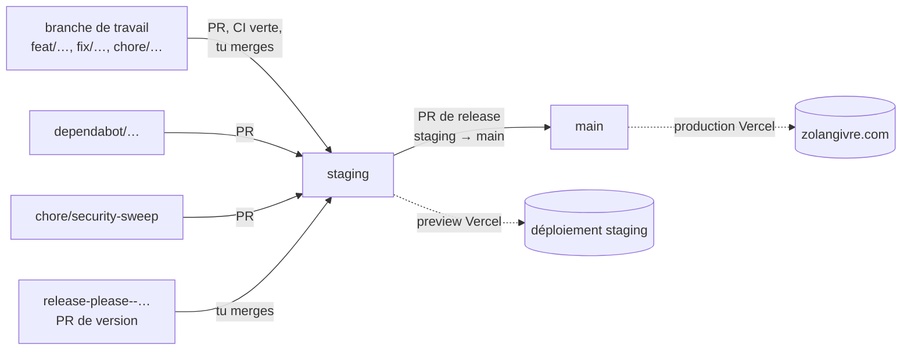

# GitHub

[English](README.md) · **Français**

Ce que contient [`.github/`](../../.github/), comment les branches avancent,
et ce qu'il faut régler sur GitHub pour que tout fonctionne. Retour à
l'[index des docs](../README.fr.md).

| Document                                       | Pour                                                                                |
| ---------------------------------------------- | ----------------------------------------------------------------------------------- |
| [CI](ci.fr.md)                                 | `ci.yml` job par job, quand les tests lents sont sautés, les deux scripts d'aide    |
| [Dependabot](dependabot.fr.md)                 | Les PR de dépendances hebdomadaires, les groupes, le délai, quoi lancer sur chacune |
| [Releases](releases.fr.md)                     | release-please, les numéros de version, les trois merges d'une release              |
| [Claude sur GitHub](../ai/github-agents.fr.md) | La revue de PR et le balayage de sécurité nocturne                                  |

## Ce que contient `.github/`

| Fichier                                                                      | Rôle                                                                                                                     | Détails                                                                |
| ---------------------------------------------------------------------------- | ------------------------------------------------------------------------------------------------------------------------ | ---------------------------------------------------------------------- |
| [`workflows/ci.yml`](../../.github/workflows/ci.yml)                         | Lint, typecheck, tests unitaires, composants, intégration et e2e, la vérification fr/en des docs. Jeton en lecture seule | [CI](ci.fr.md)                                                         |
| [`workflows/release.yml`](../../.github/workflows/release.yml)               | release-please à chaque push sur `staging` : la PR de version, puis le tag et la Release GitHub                          | [Releases](releases.fr.md)                                             |
| [`workflows/claude-review.yml`](../../.github/workflows/claude-review.yml)   | La revue d'une PR par Claude, quand le label `review` est ajouté                                                         | [Claude sur GitHub](../ai/github-agents.fr.md#la-revue-de-pr)          |
| [`workflows/security-sweep.yml`](../../.github/workflows/security-sweep.yml) | Le balayage de sécurité nocturne                                                                                         | [Claude sur GitHub](../ai/github-agents.fr.md#le-balayage-de-sécurité) |
| [`dependabot.yml`](../../.github/dependabot.yml)                             | npm chaque lundi, GitHub Actions chaque mois, des PR vers `staging`                                                      | [Dependabot](dependabot.fr.md)                                         |
| [`ci-site-changed.sh`](../../.github/ci-site-changed.sh)                     | Décide si une PR a besoin des tests d'intégration et e2e                                                                 | [CI](ci.fr.md#changes--sauter-les-tests-lents)                         |
| [`lighthouse-summary.sh`](../../.github/lighthouse-summary.sh)               | Transforme un passage Lighthouse en Summary et en annotations                                                            | [CI](ci.fr.md#lighthouse)                                              |
| [`check-doc-pairs.sh`](../../.github/check-doc-pairs.sh)                     | Fait échouer une PR qui ne modifie qu'une langue d'une doc traduite                                                      | [CI](ci.fr.md#docs-fren-synchronisées)                                 |
| [`pull_request_template.md`](../../.github/pull_request_template.md)         | Les quatre sections de chaque description de PR                                                                          | [plus bas](#le-modèle-de-pr)                                           |

## Branches

- **Chaque PR vise `staging`**, la branche d'intégration : fonctionnalités,
  correctifs, Dependabot, le balayage de sécurité, la PR de version de
  release-please. Un hotfix vers `main` est la seule exception, et `main` est
  ensuite remergé dans `staging`.
- **`main`, c'est la production.** Elle n'avance que par la PR de release
  `staging → main` (voir [Releases](releases.fr.md)).
- **Vercel ne déploie que `staging` et `main`** (`git.deploymentEnabled` dans
  [`vercel.json`](../../vercel.json)) : toute autre branche ne déclenche ni
  build ni migration. Chaque déploiement lance `pnpm run ci`, qui applique les
  migrations en attente à la base de cet environnement avant `next build`.
- **Les PR sont mergées avec un commit de merge** : chaque commit arrive tel
  quel dans `staging`, et release-please construit le CHANGELOG à partir
  d'eux.
- **Les branches ne sont pas supprimées au merge** : `/menage` s'en occupe.

## Le modèle de PR

[`pull_request_template.md`](../../.github/pull_request_template.md) donne
quatre sections à chaque description de PR. `/ship` les remplit ;
remplis-les à la main sinon :

1. **What and why** : pour quelqu'un qui n'a pas suivi le travail.
2. **Tests** : ce qui a tourné et le résultat, ou « left to CI ».
3. **To check by eye** : ce qu'aucun test ne couvre (ressenti d'une
   animation, mobile sur un vrai téléphone, mode sombre, les deux langues,
   Safari), avec des captures.
4. **Notes for the merge** : une migration que Vercel lancera, une variable
   d'env à ajouter, un constat laissé ouvert, un ordre de merge.

Le dépôt est public : rien de privé dans une PR, ses commits ou ses
commentaires (aucun secret, donnée personnelle, URL d'admin ni vulnérabilité
non corrigée).

## Installation

### Ruleset

Un seul ruleset, **`staging and main`**, dans Settings → Rules → Rulesets :

- **Une PR est obligatoire**, **sans approbation** : GitHub ne te laisse pas
  approuver ta propre PR, donc une approbation exigée bloquerait chaque
  merge.
- **Les vérifications de CI doivent passer** : Changes, Lint & typecheck,
  Unit tests, Integration tests, E2E tests, Docs fr/en in sync. Un job sauté
  par sa condition (une PR de doc seule, une PR de release) compte comme
  réussi : rien n'attend indéfiniment.
- **Les branches n'ont pas à être à jour** avant le merge, sinon chaque PR
  Dependabot devrait être rebasée à chaque fois que `staging` bouge.
- **Les push forcés et la suppression sont bloqués.**
- **Repository admin est sur la liste de contournement**, pour les urgences ;
  un contournement est journalisé. L'app Claude ne peut pas le contourner.
  Comme le `gh` local de Claude tourne avec ton jeton d'admin, c'est le
  [hook `guard-git`](../ai/hooks-and-settings.fr.md#guard-git) qui empêche
  Claude de merger ou de pousser sur ces branches.

### Réglages du dépôt

- Settings → Actions → General → **« Allow GitHub Actions to create and
  approve pull requests »** : release-please en a besoin pour ouvrir sa PR
  de version.
- **Les alertes et mises à jour de sécurité Dependabot**, et **le code
  scanning CodeQL**, activés dans Settings → Code security.

### Secrets

| Secret                    | Utilisé par               | Quoi                                                                                                           |
| ------------------------- | ------------------------- | -------------------------------------------------------------------------------------------------------------- |
| `CLAUDE_CODE_OAUTH_TOKEN` | les deux workflows Claude | `claude setup-token` avec le compte Pro ou Max                                                                 |
| `SECURITY_ALERTS_TOKEN`   | le balayage de sécurité   | Jeton à granularité fine, ce dépôt seulement, alertes Dependabot et code scanning en lecture seule ; il expire |

`ci.yml` et `release.yml` n'ont besoin d'aucun secret : ils utilisent
`GITHUB_TOKEN`. Les workflows Claude ont aussi besoin de l'app GitHub Claude
et du label `review` : voir [Claude sur GitHub](../ai/github-agents.fr.md#installation).

### Un changement de workflow prend effet sur `main`

Les workflows planifiés ne tournent que depuis la branche par défaut, et
l'action de Claude ne lance qu'un workflow dont le fichier y est identique.
Un changement de fichier de workflow s'applique une fois qu'une release l'a
amené sur `main`.

## Dépannage

| Symptôme                                                      | Cause                                                                                                             |
| ------------------------------------------------------------- | ----------------------------------------------------------------------------------------------------------------- |
| Une PR attend une vérification qui ne démarre jamais          | Le nom de la vérification a changé dans `ci.yml` mais pas dans le ruleset, ou l'inverse                           |
| Docs fr/en in sync échoue                                     | Un `<nom>.md` a changé sans son `<nom>.fr.md`, ou l'inverse. Voir [CI](ci.fr.md#docs-fren-synchronisées)          |
| Le test de dérive échoue                                      | Il manque une migration. Son message est le SQL ; lance `/new-migration`                                          |
| Tous les tests e2e échouent avec « Executable doesn't exist » | Playwright a été mis à jour : `pnpm exec playwright install chromium`                                             |
| L'intégration ou l'e2e ne se connecte pas en local            | Postgres ne tourne pas : `docker compose up -d postgres`                                                          |
| release-please n'ouvre pas sa PR                              | Le réglage Actions ci-dessus est désactivé, ou aucun commit depuis la dernière release n'est `feat`/`fix`/`perf`… |
| Un commit manque dans le CHANGELOG                            | Son message n'est pas Conventional, ou son type est masqué (`chore`, `docs`…). Voir [Releases](releases.fr.md)    |

Les workflows Claude ont leur propre tableau dans
[Claude sur GitHub](../ai/github-agents.fr.md#dépannage).
