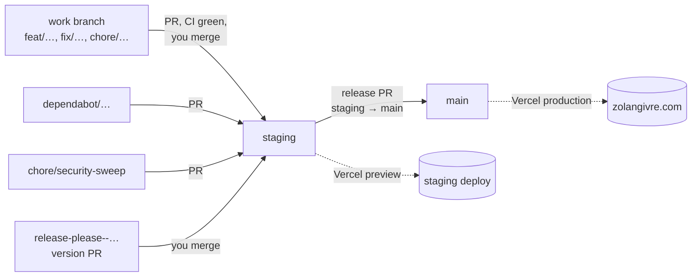

# GitHub

**English** · [Français](README.fr.md)

What's in [`.github/`](../../.github/), how branches move, and what has to be
set up on GitHub for it all to work. Back to the [docs index](../README.md).

| Document                                   | For                                                                          |
| ------------------------------------------ | ---------------------------------------------------------------------------- |
| [CI](ci.md)                                | `ci.yml` job by job, when the slow tests are skipped, the two helper scripts |
| [Dependabot](dependabot.md)                | Weekly dependency PRs, groups, the cooldown, what to run on each one         |
| [Releases](releases.md)                    | release-please, version numbers, the three merges of a release               |
| [Claude on GitHub](../ai/github-agents.md) | The PR review and the nightly security sweep                                 |

## What's in `.github/`

| File                                                                         | Role                                                                                               | Details                                                       |
| ---------------------------------------------------------------------------- | -------------------------------------------------------------------------------------------------- | ------------------------------------------------------------- |
| [`workflows/ci.yml`](../../.github/workflows/ci.yml)                         | Lint, typecheck, unit, component, integration and e2e tests, the fr/en docs check. Read-only token | [CI](ci.md)                                                   |
| [`workflows/release.yml`](../../.github/workflows/release.yml)               | release-please on every push to `staging`: the version PR, then the tag and the GitHub Release     | [Releases](releases.md)                                       |
| [`workflows/claude-review.yml`](../../.github/workflows/claude-review.yml)   | Claude's review of a PR, when the `review` label is added                                          | [Claude on GitHub](../ai/github-agents.md#the-pr-review)      |
| [`workflows/security-sweep.yml`](../../.github/workflows/security-sweep.yml) | The nightly security sweep                                                                         | [Claude on GitHub](../ai/github-agents.md#the-security-sweep) |
| [`dependabot.yml`](../../.github/dependabot.yml)                             | npm every Monday, GitHub Actions every month, PRs against `staging`                                | [Dependabot](dependabot.md)                                   |
| [`ci-site-changed.sh`](../../.github/ci-site-changed.sh)                     | Decides whether a PR needs the integration and e2e tests                                           | [CI](ci.md#changes-skipping-the-slow-tests)                   |
| [`lighthouse-summary.sh`](../../.github/lighthouse-summary.sh)               | Turns a Lighthouse run into a Summary and annotations                                              | [CI](ci.md#lighthouse)                                        |
| [`check-doc-pairs.sh`](../../.github/check-doc-pairs.sh)                     | Fails a PR that changes one language of a translated doc only                                      | [CI](ci.md#docs-fren-in-sync)                                 |
| [`pull_request_template.md`](../../.github/pull_request_template.md)         | The four sections of every PR body                                                                 | [below](#the-pr-template)                                     |

## Branches

- **Every PR targets `staging`**, the integration branch: features, fixes,
  Dependabot, the security sweep, release-please's version PR. A hotfix into
  `main` is the only exception, and `main` is merged back into `staging`
  afterwards.
- **`main` is production.** It only moves through the `staging → main` release
  PR (see [Releases](releases.md)).
- **Vercel deploys only `staging` and `main`** (`git.deploymentEnabled` in
  [`vercel.json`](../../vercel.json)): every other branch triggers no build
  and no migration. Each deploy runs `pnpm run ci`, which applies pending
  migrations to that environment's database before `next build`.
- **PRs are merged with a merge commit**, so every commit lands in `staging`
  as is, and release-please builds the CHANGELOG from them.
- **Branches aren't deleted on merge**: `/menage` cleans them up.

## The PR template

[`pull_request_template.md`](../../.github/pull_request_template.md) gives
every PR body four sections. `/ship` fills them in; fill them in by hand
otherwise:

1. **What and why**, for someone who didn't follow the work.
2. **Tests**: what ran and the result, or "left to CI".
3. **To check by eye**: what no test covers (animation feel, mobile on a real
   phone, dark mode, both locales, Safari), with screenshots.
4. **Notes for the merge**: a migration Vercel will run, an env var to add, a
   finding left open, an order to merge in.

The repository is public: nothing private in a PR, its commits or its
comments (no secret, personal data, admin URL, or unfixed vulnerability).

## Setup

### Ruleset

One ruleset, **`staging and main`**, in Settings → Rules → Rulesets:

- **A PR is required**, with **no approval**: GitHub won't let you approve
  your own PR, so one approval would block every merge.
- **The CI checks must pass**: Changes, Lint & typecheck, Unit tests,
  Integration tests, E2E tests, Docs fr/en in sync. A job skipped by its
  condition (a docs-only PR, a release PR) counts as passed, so nothing waits
  forever.
- **Branches don't have to be up to date** before merging, or every
  Dependabot PR would need a rebase each time `staging` moves.
- **Force pushes and deletion are blocked.**
- **Repository admin is on the bypass list**, for emergencies; a bypass is
  logged. The Claude App can't bypass it. Since Claude's local `gh` runs with
  your admin token, the [`guard-git` hook](../ai/hooks-and-settings.md#guard-git)
  is what stops Claude from merging or pushing to these branches.

### Repository settings

- Settings → Actions → General → **"Allow GitHub Actions to create and approve
  pull requests"**: release-please needs it to open its version PR.
- **Dependabot alerts and security updates**, and **CodeQL code scanning**,
  enabled in Settings → Code security.

### Secrets

| Secret                    | Used by               | What                                                                                     |
| ------------------------- | --------------------- | ---------------------------------------------------------------------------------------- |
| `CLAUDE_CODE_OAUTH_TOKEN` | both Claude workflows | `claude setup-token` with the Pro or Max account                                         |
| `SECURITY_ALERTS_TOKEN`   | the security sweep    | Fine-grained PAT, this repo only, Dependabot and code scanning alerts read-only; expires |

`ci.yml` and `release.yml` need no secret: they use `GITHUB_TOKEN`. The
Claude workflows also need the Claude GitHub App and the `review` label: see
[Claude on GitHub](../ai/github-agents.md#setup).

### Workflow changes take effect on `main`

Scheduled workflows only run from the default branch, and Claude's action
only runs a workflow whose file is identical there. A change to a workflow
file applies once a release brings it to `main`.

## Troubleshooting

| Symptom                                              | Cause                                                                                                 |
| ---------------------------------------------------- | ----------------------------------------------------------------------------------------------------- |
| A PR waits on a check that never starts              | The check's name changed in `ci.yml` but not in the ruleset, or the reverse                           |
| Docs fr/en in sync fails                             | A `<name>.md` changed without its `<name>.fr.md`, or the reverse. See [CI](ci.md#docs-fren-in-sync)   |
| The drift test fails                                 | A migration is missing. Its message is the SQL; run `/new-migration`                                  |
| Every e2e test fails with "Executable doesn't exist" | Playwright was upgraded: `pnpm exec playwright install chromium`                                      |
| Integration or e2e can't connect locally             | Postgres isn't running: `docker compose up -d postgres`                                               |
| release-please doesn't open its PR                   | The Actions setting above is off, or no commit since the last release is `feat`/`fix`/`perf`…         |
| A commit is missing from the CHANGELOG               | Its message isn't Conventional, or its type is hidden (`chore`, `docs`…). See [Releases](releases.md) |

The Claude workflows have their own table in
[Claude on GitHub](../ai/github-agents.md#troubleshooting).
