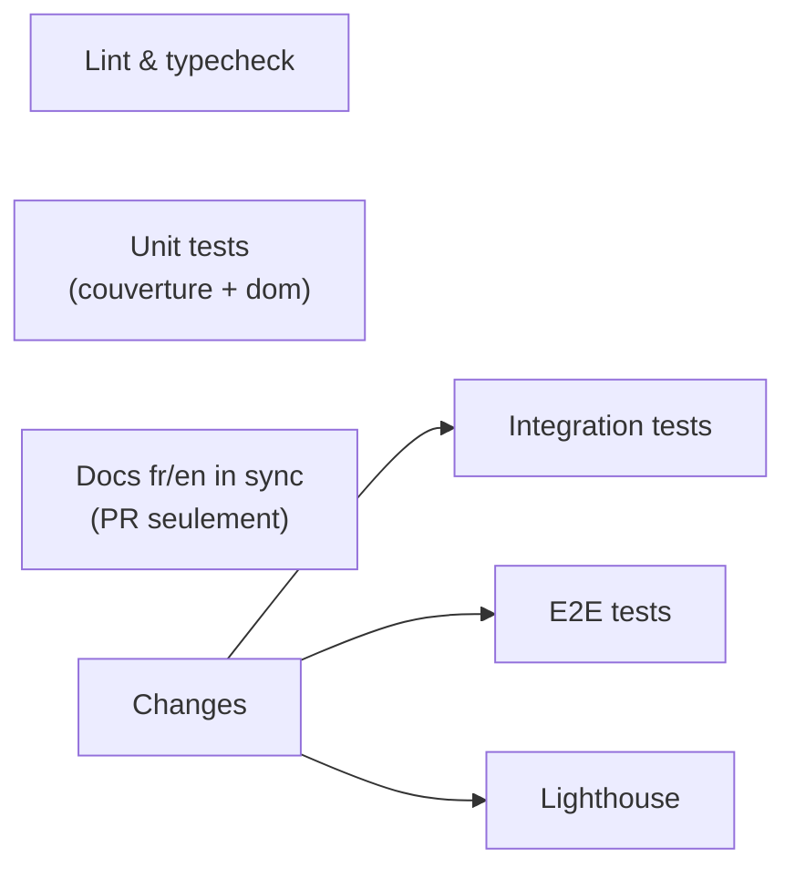

# CI

[English](ci.md) · **Français**

[`.github/workflows/ci.yml`](../../.github/workflows/ci.yml), job par job, et
ses deux scripts d'aide. Retour à [GitHub](README.fr.md).

**Tourne** à chaque push sur `main` et `staging`, et sur chaque pull request.
Un nouveau push sur la même branche annule le passage en cours. Le jeton est
en lecture seule (`permissions: contents: read`), et aucun job n'utilise de
secret.



| Job                | Fait                                                                                                              | Postgres    | Durée    |
| ------------------ | ----------------------------------------------------------------------------------------------------------------- | ----------- | -------- |
| Lint & typecheck   | `pnpm lint`, `pnpm exec tsc --noEmit`, [`pnpm knip`](#knip)                                                       | non         | ~1 min   |
| Unit tests         | `pnpm test:coverage` (échoue sous 90 %), puis `pnpm test:dom` (les composants dans jsdom, une seconde environ)    | non         | ~30 s    |
| Docs fr/en in sync | [`check-doc-pairs.sh`](#docs-fren-synchronisées), sur les PR seulement                                            | non         | secondes |
| Changes            | [`ci-site-changed.sh`](#changes--sauter-les-tests-lents) : les jobs lents doivent-ils tourner ?                   | non         | secondes |
| Integration tests  | `pnpm test:int` : la vraie Local API de Payload, [test de dérive du schéma](#le-test-de-dérive-du-schéma) compris | oui, vide   | ~50 s    |
| E2E tests          | `pnpm test:e2e` : Chromium et `mobile-safari` (iPhone 15, WebKit) sur le build de production avec contenu de test | oui, rempli | ~4 min   |
| Lighthouse         | [`pnpm lighthouse`](#lighthouse) : budgets de performance sur le même build, en simple avertissement              | oui, rempli | ~4 min   |

Chaque job tourne sur Ubuntu avec Node 24 et `pnpm install --frozen-lockfile`.
Les six premiers sont des vérifications obligatoires du
[ruleset](README.fr.md#ruleset) (leurs noms doivent y correspondre). Pas
Lighthouse : les temps d'un runner partagé varient trop pour bloquer un merge.

## Quand un job est sauté

Chaque job sauf Docs est sauté quand le code a déjà été testé (la condition
`&run-ci`, définie une fois sur le premier job et réutilisée) :

- le passage `pull_request` de la **PR `staging → main`** : le passage push
  sur `staging` teste déjà le même commit ;
- **la PR de version de release-please** (branche `release-please--…`), et
  son merge dans `staging` (`Merge pull request … release-please--` ou
  `chore(staging): version X.Y.Z`) : elle ne touche que `package.json` et
  `CHANGELOG.md`.

Docs ne tourne que sur les PR, moins les deux mêmes.

Un job sauté par sa condition compte comme réussi pour le ruleset, ce que
sauter tout le workflow avec `paths:` ne ferait pas : rien n'attend
indéfiniment.

## Changes : sauter les tests lents

Sur une pull request, [`ci-site-changed.sh`](../../.github/ci-site-changed.sh)
décide si l'intégration, l'e2e et Lighthouse doivent tourner. Il
liste ce qui peut être sauté **sans risque**, pas ce qui est risqué :

| Fichiers modifiés                                                                                                              | Intégration et e2e |
| ------------------------------------------------------------------------------------------------------------------------------ | ------------------ |
| Seulement `docs/`, tout `*.md`, `.claude/`, `.githooks/`, `.github/` (hors ligne suivante)                                     | sautés             |
| `.github/workflows/ci.yml` ou `.github/ci-site-changed.sh` (un changement doit faire ses preuves)                              | lancés             |
| Tout le reste : `src/`, `tests/`, `package.json`, le lockfile, une config, une migration, un fichier auquel personne n'a pensé | lancés             |
| Aucun fichier modifié trouvé                                                                                                   | lancés             |

Il écrit `site=true|false` dans la sortie du job et la raison dans le Summary
du passage. **Échec fermé** : ces jobs ne sont sautés que si Changes a
tourné, a réussi et a dit `false`. Si Changes a échoué, ils
tournent quand même. Les push sur `staging` et `main` lancent toujours tout :
c'est ce que Vercel déploie.

Pour voir en local ce qu'aurait une branche :

```sh
bash .github/ci-site-changed.sh origin/staging
```

## Docs fr/en synchronisées

[`check-doc-pairs.sh`](../../.github/check-doc-pairs.sh) fait échouer une PR
qui modifie une langue d'un document traduit et pas l'autre. Les paires sont
trouvées, pas listées : chaque `<nom>.fr.md` suivi par git va avec
`<nom>.md`, donc `README.md` et chaque fichier de `docs/` sont couverts dès
que leur jumeau existe. Ajouter ou supprimer une paire compte comme modifier
les deux.

Pour un changement vraiment d'un seul côté (une faute en français, un lien
que seule une version a), ajoute cette ligne à l'un des messages de commit de
la PR :

```txt
Docs-Sync: skip
```

En local : `bash .github/check-doc-pairs.sh origin/staging`.

## Tests d'intégration

Un service `postgres:16-alpine` avec la base de `.env.test`
(`payload-portfolio-test`) : la suite tourne sans config propre à la CI. La
base part vide : la mise en place globale de la suite la construit avec
`payload migrate:fresh`, à partir des seules migrations. Ça prouve aussi
qu'un `payload migrate` à neuf (un nouvel environnement, une branche de
preview) marche toujours. La suite refuse de démarrer si `DATABASE_URL`
n'est pas une base locale nommée `*-test`, et ne lit jamais `.env`.

### Le test de dérive du schéma

[`tests/int/schemaDrift.int.spec.ts`](../../tests/int/schemaDrift.int.spec.ts)
tourne avec la suite d'intégration, en local et en CI. Il construit la base à
partir des seules migrations, demande à Drizzle ce qu'il changerait pour
coller à la config, et échoue avec ce SQL. Un changement de schéma sans sa
migration fait donc échouer la CI, qu'il vienne de ta config ou d'une mise à
jour de Payload, et le message d'échec est le point de départ de la migration
([`/new-migration`](../ai/skills.fr.md#new-migration-slug)). Les valeurs par
défaut des colonnes sont ignorées : Payload les applique lui-même.

## Tests e2e

Un service Postgres avec la base de `.env.e2e`
(`payload-portfolio-e2e-test`). Le serveur web de Playwright,
[`tests/e2e/serve.ts`](../../tests/e2e/serve.ts), construit la base à partir
des migrations, y met le contenu de `tests/e2e/fixtures.ts`, puis lance
`next build` (dans `.next-e2e`) et `next start` sur le port 3100 : le même
build de production que celui que déploie Vercel.

- **Projets** : `chromium` (desktop) lance tout ; `mobile-safari` (iPhone 15
  sur WebKit) lance les specs de navigation et du menu mobile. Les deux
  navigateurs s'installent avec
  `playwright install --with-deps chromium webkit`. WebKit ne s'installe pas
  sur le Mac du mainteneur : la CI est le seul endroit où il tourne. Voir
  [`webkit-reviewer`](../ai/subagents.fr.md#webkit-reviewer).
- **Relances** : 2 en CI. Un test qui passe à la relance est marqué flaky
  dans le log : [`/flaky`](../ai/skills.fr.md#flaky-e2eunitint---repeat-n)
  les traque.
- **Rapport** : toujours envoyé comme artefact `playwright-report`, gardé 7
  jours, avec une vidéo, une capture et une trace complète pour chaque échec.
  Télécharge-le, puis `pnpm exec playwright show-report <dossier>`.

## Lighthouse

[`lighthouserc.cjs`](../../lighthouserc.cjs) mesure trois pages, trois fois
chacune, sur le build de production de
[`tests/e2e/serve.ts`](../../tests/e2e/serve.ts), et garde le passage médian.

- **Budgets** : score de performance, score d'accessibilité, décalage de mise
  en page, temps de blocage, poids des scripts et poids total. Ils ne font
  qu'avertir. Un budget dépassé est une annotation sur le passage, et le
  Summary donne les scores de chaque page
  ([`lighthouse-summary.sh`](../../.github/lighthouse-summary.sh)). Rien
  n'échoue à cause d'eux.
- **Ce que ça ne dit pas** : le contenu de test n'a ni images ni vidéo, donc
  pas de budget sur le LCP, et les poids ne concernent que le code. Les vrais
  visiteurs sont dans Speed Insights, sur Vercel.
- **Rapport** : envoyé comme artefact `lighthouse-report`, gardé 7 jours.
  Ouvre les fichiers `.html`.
- **`pnpm dlx`, pas une dépendance** : `@lhci/cli` ajouterait environ 200
  paquets et 8 alertes d'audit, pour un outil qui ne part jamais en production.
  La version est figée dans le script `lighthouse` de `package.json`, Dependabot
  ne la suit donc pas : à monter à la main.

Pour trouver ce qui a grossi, `pnpm analyze` ouvre l'analyseur de bundle de
Next. `pnpm lighthouse` se lance en local avec Postgres démarré : il utilise le
port 3100 et la base e2e.

## Knip

`pnpm knip` échoue sur un fichier, une dépendance ou un export inutilisé. Comme
c'est le job Lint, obligatoire, un faux positif bloque un merge : déclare-le
dans [`knip.jsonc`](../../knip.jsonc), qui dit déjà pourquoi `prettier`,
`tests/e2e/prepare.ts` et les tokens de mouvement restent.

## Lire un passage rouge

```sh
gh pr checks <n>
gh run view <run-id> --log-failed | grep -iE -m20 "error|failed|✘|expected"
```

Un échec d'infrastructure (téléchargement de police, registre npm, réseau,
runner) qui est vert sur `staging` pour le même code mérite une relance
(`gh run rerun <run-id> --failed`). S'il échoue encore, il est réel. C'est
exactement ce que fait `/ship` quand il suit la CI d'une PR.
