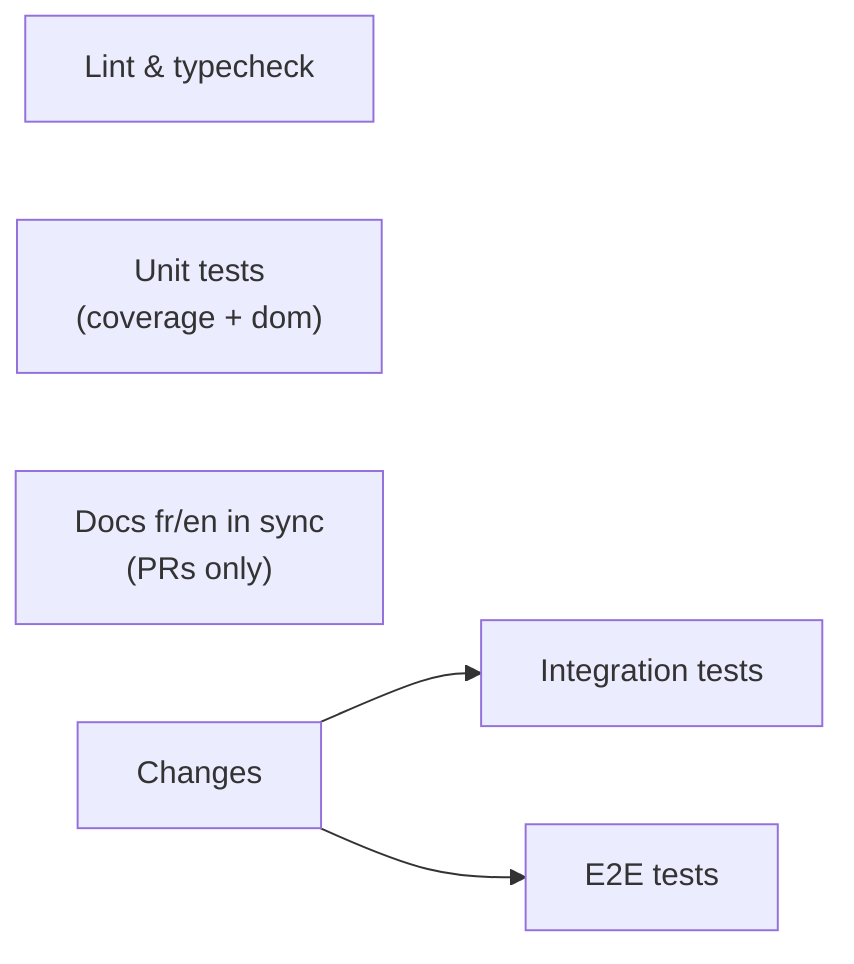

# CI

**English** · [Français](ci.fr.md)

[`.github/workflows/ci.yml`](../../.github/workflows/ci.yml), job by job, and
its two helper scripts. Back to [GitHub](README.md).

**Runs** on every push to `main` and `staging`, and on every pull request. A
new push to the same branch cancels the run in progress. The token is
read-only (`permissions: contents: read`), and no job uses a secret.



| Job                | Does                                                                                                  | Needs Postgres | Time    |
| ------------------ | ----------------------------------------------------------------------------------------------------- | -------------- | ------- |
| Lint & typecheck   | `pnpm lint`, `pnpm exec tsc --noEmit`                                                                 | no             | ~40 s   |
| Unit tests         | `pnpm test:coverage` (fails under 90%), then `pnpm test:dom` (components in jsdom, about a second)    | no             | ~30 s   |
| Docs fr/en in sync | [`check-doc-pairs.sh`](#docs-fren-in-sync), on PRs only                                               | no             | seconds |
| Changes            | [`ci-site-changed.sh`](#changes-skipping-the-slow-tests): do the slow jobs need to run?               | no             | seconds |
| Integration tests  | `pnpm test:int`: the real Payload Local API, the [schema drift test](#the-schema-drift-test) included | yes, empty     | ~50 s   |
| E2E tests          | `pnpm test:e2e`: Chromium and `mobile-safari` (iPhone 15, WebKit) against the seeded production build | yes, seeded    | ~4 min  |

Every job runs on Ubuntu with Node 24 and `pnpm install --frozen-lockfile`.
All six are required checks of the [ruleset](README.md#ruleset) (their names
must match it).

## When a job is skipped

Every job except Docs is skipped when the code was already tested (the
`&run-ci` condition, defined once on the first job and reused):

- the `pull_request` run of the **`staging → main` PR**: the push run on
  `staging` already tests the same commit;
- **release-please's version PR** (branch `release-please--…`), and its merge
  into `staging` (`Merge pull request … release-please--` or
  `chore(staging): version X.Y.Z`): it only touches `package.json` and
  `CHANGELOG.md`.

Docs runs on PRs only, minus the same two.

A job skipped by its condition counts as passed for the ruleset, which
skipping the whole workflow with `paths:` wouldn't: nothing waits forever.

## Changes: skipping the slow tests

On a pull request, [`ci-site-changed.sh`](../../.github/ci-site-changed.sh)
decides whether integration and e2e (about 5 minutes) need to run. It lists
what is **safe** to skip, not what is risky:

| Changed files                                                                                                  | Integration and e2e |
| -------------------------------------------------------------------------------------------------------------- | ------------------- |
| Only `docs/`, any `*.md`, `.claude/`, `.githooks/`, `.github/` (other than below)                              | skipped             |
| `.github/workflows/ci.yml` or `.github/ci-site-changed.sh` (a change must prove itself)                        | run                 |
| Anything else: `src/`, `tests/`, `package.json`, the lockfile, a config, a migration, a file nobody thought of | run                 |
| No changed file found                                                                                          | run                 |

It writes `site=true|false` to the job's output and the reason to the run's
Summary. **Fail closed**: integration and e2e are skipped only when Changes
ran, succeeded, and said `false`. If Changes failed, they run anyway. Pushes
to `staging` and `main` always run everything: that's what Vercel deploys.

Run it locally to see what a branch would get:

```sh
bash .github/ci-site-changed.sh origin/staging
```

## Docs fr/en in sync

[`check-doc-pairs.sh`](../../.github/check-doc-pairs.sh) fails a PR that
changes one language of a translated document and not the other. Pairs are
found, not listed: every tracked `<name>.fr.md` goes with `<name>.md`, so
`README.md` and every file under `docs/` are covered as soon as their twin
exists. Adding or deleting a pair counts as changing both.

For a change that really is one-sided (a French typo, a link only one
version has), add this line to one of the PR's commit messages:

```txt
Docs-Sync: skip
```

Locally: `bash .github/check-doc-pairs.sh origin/staging`.

## Integration tests

A `postgres:16-alpine` service with the database of `.env.test`
(`payload-portfolio-test`), so the suite runs with no CI-specific config. The
database starts empty: the suite's global setup builds it with
`payload migrate:fresh`, from the migrations alone. That also proves a fresh
`payload migrate` (a new environment, a preview branch) still works. The
suite refuses to start unless `DATABASE_URL` is a local database named
`*-test`, and never reads `.env`.

### The schema drift test

[`tests/int/schemaDrift.int.spec.ts`](../../tests/int/schemaDrift.int.spec.ts)
runs with the integration suite, locally and in CI. It builds the database
from the migrations alone, asks Drizzle what it would change to match the
config, and fails with that SQL. So a schema change without its migration
fails CI, whether it comes from your config or from a Payload upgrade, and
the failure message is the migration's starting point
([`/new-migration`](../ai/skills.md#new-migration-slug)). Column defaults are
ignored: Payload applies them itself.

## E2E tests

A Postgres service with the database of `.env.e2e`
(`payload-portfolio-e2e-test`). Playwright's web server,
[`tests/e2e/serve.ts`](../../tests/e2e/serve.ts), builds the database from
the migrations, seeds the content of `tests/e2e/fixtures.ts`, then runs
`next build` (into `.next-e2e`) and `next start` on port 3100: the same
production build Vercel deploys.

- **Projects**: `chromium` (desktop) runs everything; `mobile-safari`
  (iPhone 15 on WebKit) runs the navigation and mobile-menu specs. Both
  browsers are installed with `playwright install --with-deps chromium webkit`.
  WebKit doesn't install on the maintainer's Mac, so CI is the only place it
  runs: see [`webkit-reviewer`](../ai/subagents.md#webkit-reviewer).
- **Retries**: 2 on CI. A test that passes on retry is marked flaky in the
  log: [`/flaky`](../ai/skills.md#flaky-e2eunitint---repeat-n) hunts them.
- **Report**: always uploaded as the `playwright-report` artifact, kept 7
  days, with a video, a screenshot and a full trace for each failure.
  Download it, then `pnpm exec playwright show-report <folder>`.

## Reading a red run

```sh
gh pr checks <n>
gh run view <run-id> --log-failed | grep -iE -m20 "error|failed|✘|expected"
```

An infrastructure failure (font download, npm registry, network, runner)
that is green on `staging` for the same code is worth one rerun
(`gh run rerun <run-id> --failed`). If it fails again, it's real. `/ship`
does exactly this when it follows a PR's CI.
