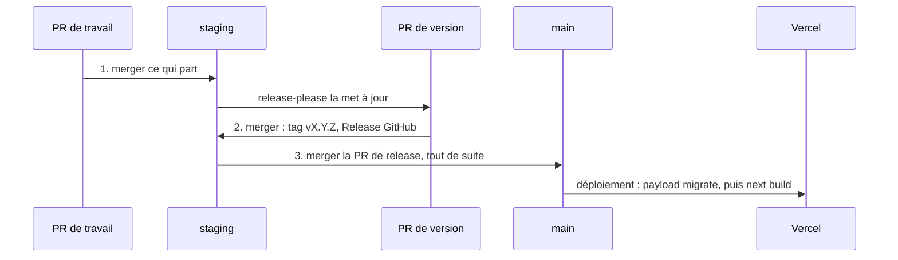

# Releases

[English](releases.md) · **Français**

Comment un numéro de version est choisi, et comment `staging` arrive en
production. Fichiers :
[`release.yml`](../../.github/workflows/release.yml),
[`release-please-config.json`](../../release-please-config.json),
[`.release-please-manifest.json`](../../.release-please-manifest.json).
Retour à [GitHub](README.fr.md).

## Les versions viennent des messages de commit

Des numéros [SemVer](https://semver.org), calculés par
[release-please](https://github.com/googleapis/release-please) à partir des
[Conventional Commits](https://www.conventionalcommits.org). Le
[hook `commit-msg`](../git-hooks.fr.md) refuse tout autre format, puisqu'un
message mal formé serait ignoré et que son changement n'apparaîtrait dans
aucune release.

| Commit                                          | Version                 | Section du CHANGELOG |
| ----------------------------------------------- | ----------------------- | -------------------- |
| `feat: …`                                       | mineure : 1.3.1 → 1.4.0 | Nouveautés           |
| `fix: …`                                        | patch : 1.3.1 → 1.3.2   | Corrections          |
| `perf: …`                                       | patch                   | Performances         |
| `refactor: …`                                   | patch, s'il est seul    | Refactorisation      |
| `revert: …`                                     | patch                   | Retours en arrière   |
| `feat!: …` ou `BREAKING CHANGE:` dans le corps  | majeure : 1.3.1 → 2.0.0 | ⚠ BREAKING CHANGES   |
| `docs`, `test`, `ci`, `build`, `style`, `chore` | aucune à eux seuls      | masqués              |

Les sections sont en français, réglées dans `changelog-sections`. Les tags
sont `vX.Y.Z` (`include-v-in-tag`), la première version était 1.0.0
(`initial-version`), et la version courante est dans
`.release-please-manifest.json` et `package.json`. Aucun des deux ne se
modifie à la main : le
[hook `protect-files`](../ai/hooks-and-settings.fr.md#protect-files) le
refuse, et `guard-git` refuse `pnpm version`.

Comme les PR sont mergées avec un commit de merge, chaque commit d'une PR
arrive tel quel dans le CHANGELOG. Un commit qui répare le propre travail de
la branche prend `test`, `refactor` ou `chore`, pas `fix` : il ne corrige rien
de ce qui est parti.

## `release.yml`

À chaque push sur `staging`, release-please garde une **PR de version**
ouverte vers `staging` (branche `release-please--branches--staging--…`, titre
`chore(staging): version X.Y.Z`). Elle monte `package.json` et le manifeste,
et écrit l'entrée du CHANGELOG à partir des commits depuis la dernière
release. Elle se met à jour après chaque push.

La merger crée le tag `vX.Y.Z` et la Release GitHub.

- C'est le seul workflow qui a des droits d'écriture (`contents` et
  `pull-requests`), séparé de `ci.yml` pour cette raison.
- L'action est figée sur un commit, pas sur le tag `v5` : un tag peut être
  déplacé vers n'importe quel code. Dependabot monte le SHA.
- Il faut activer Settings → Actions → General → « Allow GitHub Actions to
  create and approve pull requests ».
- La CI saute la PR de version et son merge : ils ne modifient que
  `package.json`, le manifeste et `CHANGELOG.md`.

La release se prépare sur `staging`, pas sur `main`, pour que le merge
`staging → main` ne déploie sur Vercel qu'une fois, avec le bon numéro de
version. Même fonctionnement que patateprod-front et patateprod-back.

## Les trois merges d'une release

1. **Les PR qui partent**, dans `staging`.
2. **La PR de version de release-please**, dans `staging`, une fois qu'elle
   les liste.
3. **La PR `staging → main`**, juste après. Vercel déploie `main` et lance
   `payload migrate` sur la base de production (`pnpm run ci` dans
   `vercel.json`).

Un commit qui arrive sur `staging` entre 2 et 3 part sous la nouvelle version
sans être dans son CHANGELOG. Une migration qui échoue en 3 fait échouer le
build de production, et le déploiement précédent reste en ligne.

[`/release`](../ai/skills.fr.md#release-et-release-verify) prépare tout ça :
ce qui part et ce qui attend, staging vert en CI et sur Vercel, chaque
migration lue, la PR de release écrite, et l'ordre des merges. Tu merges.
Après le déploiement, `/release verify` vérifie le build, les migrations, les
erreurs d'exécution, les pages principales et la release GitHub.

## Hotfix

Un bug en production alors que `staging` contient du travail qui ne doit pas
encore partir : branche depuis `origin/main`, PR vers `main` (`/bug` le fait,
avec ton accord), puis remerge `main` dans `staging` pour que le correctif ne
se perde pas à la release suivante.
