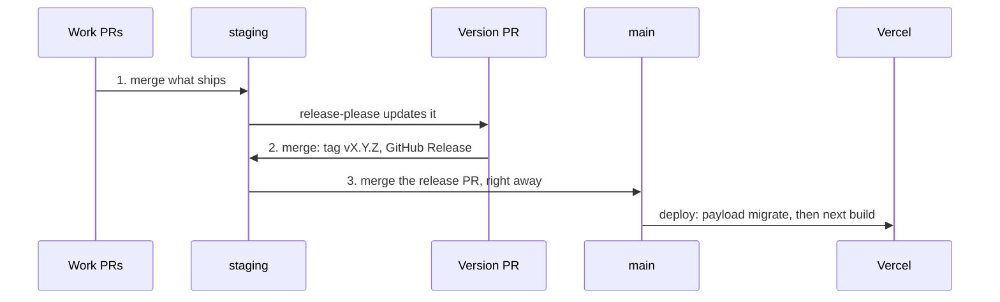

# Releases

**English** · [Français](releases.fr.md)

How a version number is chosen, and how `staging` reaches production. Files:
[`release.yml`](../../.github/workflows/release.yml),
[`release-please-config.json`](../../release-please-config.json),
[`.release-please-manifest.json`](../../.release-please-manifest.json). Back
to [GitHub](README.md).

## Versions come from commit messages

[SemVer](https://semver.org) numbers, worked out by
[release-please](https://github.com/googleapis/release-please) from
[Conventional Commits](https://www.conventionalcommits.org). The
[`commit-msg` hook](../git-hooks.md) refuses any other format, since a
malformed message would be ignored and its change would show up in no
release.

| Commit                                          | Version              | CHANGELOG section  |
| ----------------------------------------------- | -------------------- | ------------------ |
| `feat: …`                                       | minor: 1.3.1 → 1.4.0 | Nouveautés         |
| `fix: …`                                        | patch: 1.3.1 → 1.3.2 | Corrections        |
| `perf: …`                                       | patch                | Performances       |
| `refactor: …`                                   | patch, if it's alone | Refactorisation    |
| `revert: …`                                     | patch                | Retours en arrière |
| `feat!: …` or `BREAKING CHANGE:` in the body    | major: 1.3.1 → 2.0.0 | ⚠ BREAKING CHANGES |
| `docs`, `test`, `ci`, `build`, `style`, `chore` | none on their own    | hidden             |

The sections are in French, set in `changelog-sections`. Tags are `vX.Y.Z`
(`include-v-in-tag`), the first version was 1.0.0 (`initial-version`), and
the current one is in `.release-please-manifest.json` and `package.json`.
Neither file is edited by hand: the
[`protect-files` hook](../ai/hooks-and-settings.md#protect-files) refuses
it, and `guard-git` refuses `pnpm version`.

Since PRs are merged with a merge commit, every commit of a PR lands in the
CHANGELOG as is. A commit that repairs the branch's own work takes `test`,
`refactor` or `chore`, not `fix`: it fixes nothing that shipped.

PR titles stay plain sentences, with no Conventional prefix. GitHub copies the
title into the merge commit's body, and release-please reads a Conventional
line there as one more commit: the same change would show up twice. GitHub
offers no setting that keeps the classic merge title with an empty body.

## `release.yml`

On every push to `staging`, release-please keeps one **version PR** open
against `staging` (branch `release-please--branches--staging--…`, title
`chore(staging): version X.Y.Z`). It bumps `package.json` and the manifest,
and writes the CHANGELOG entry from the commits since the last release. It
refreshes after each push.

Merging it creates the `vX.Y.Z` tag and the GitHub Release.

- It's the only workflow with write access (`contents` and `pull-requests`),
  kept separate from `ci.yml` for that reason.
- The action is pinned to a commit, not the `v5` tag: a tag can be moved to
  any code. Dependabot bumps the SHA.
- It needs Settings → Actions → General → "Allow GitHub Actions to create and
  approve pull requests".
- CI skips the version PR and its merge: they only change `package.json`,
  the manifest and `CHANGELOG.md`.

The release is prepared on `staging`, not `main`, so that the
`staging → main` merge deploys to Vercel once, with the right version number.
Same flow as patateprod-front and patateprod-back.

## The three merges of a release

1. **The PRs that ship**, into `staging`.
2. **release-please's version PR**, into `staging`, once it lists them.
3. **The `staging → main` PR**, right after. Vercel deploys `main` and runs
   `payload migrate` on the production database (`pnpm run ci` in
   `vercel.json`).

A commit that reaches `staging` between 2 and 3 ships under the new version
without being in its CHANGELOG. A migration that fails at 3 fails the
production build, and the previous deployment stays live.

[`/release`](../ai/skills.md#release-and-release-verify) prepares all of
this: what ships and what waits, staging green on CI and Vercel, every
migration read, the release PR written, and the merge order. You merge.
After the deploy, `/release verify` checks the build, the migrations, the
runtime errors, the main pages and the GitHub release.

## Hotfix

A bug in production while `staging` holds work that mustn't ship yet:
branch from `origin/main`, PR into `main` (`/bug` does it, with your OK),
then merge `main` back into `staging` so the fix isn't lost at the next
release.
